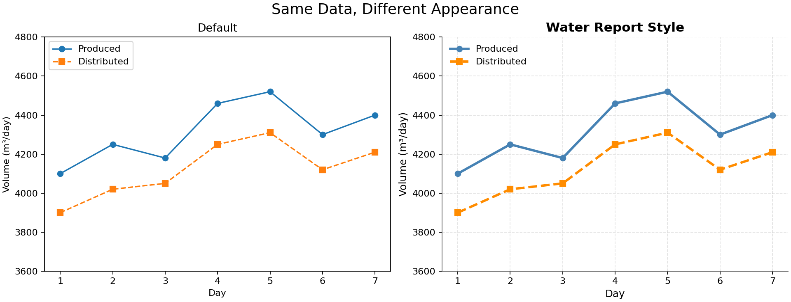
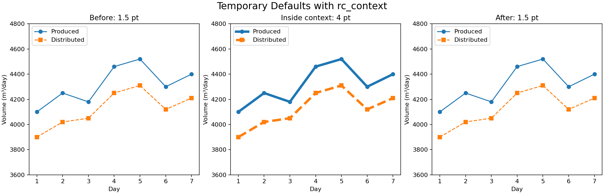
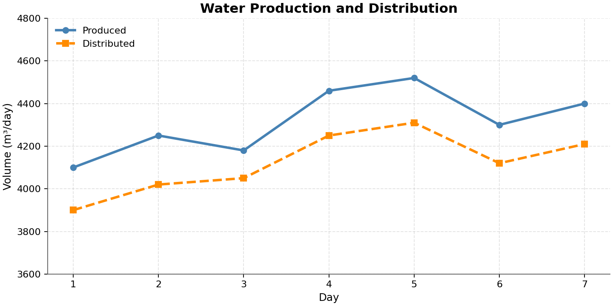

# EP11 — Customizing Matplotlib: Configurations and Stylesheets

## รูปแบบกราฟสำหรับรายงานโรงผลิตและจ่ายน้ำประปา

กราฟรายงานหลายใบมักใช้รูปแบบร่วมกัน เช่น ขนาดตัวอักษร ความหนาเส้น และสีพื้นหลัง บทนี้ใช้ข้อมูลปริมาณน้ำผลิตและน้ำจ่าย 7 วัน เพื่อเปรียบเทียบการปรับกราฟทีละส่วนกับการกำหนดรูปแบบที่นำกลับมาใช้ซ้ำได้

ทั้งสองกราฟใช้ข้อมูลและช่วงแกนเดียวกัน สิ่งที่เปลี่ยนคือรูปลักษณ์ ไม่ใช่ค่าปริมาณน้ำ

## สิ่งที่จะได้เรียนรู้

- ปรับคุณสมบัติของกราฟเฉพาะใบผ่าน Figure, Axes และเส้นกราฟ
- กำหนดค่าเริ่มต้นด้วย `mpl.rcParams`
- ใช้ `mpl.rc_context()` ตั้งค่าชั่วคราวแล้วคืนค่าเดิม
- เลือกสไตล์สำเร็จรูปด้วย `plt.style.use()` และ `plt.style.context()`
- เก็บรูปแบบที่ใช้ประจำไว้ในไฟล์ `.mplstyle`

ความแตกต่างโดยย่อ:

| วิธี | สิ่งที่กำหนด | ตัวอย่าง |
|---|---|---|
| ปรับ Object โดยตรง | คุณสมบัติของ Object ที่ระบุ | `ax.set_facecolor("whitesmoke")` |
| `rcParams` | ค่าเริ่มต้นร่วมสำหรับการสร้างองค์ประกอบกราฟ | `mpl.rcParams["lines.linewidth"] = 3` |
| Stylesheet | ชุดค่าเริ่มต้นที่บันทึกไว้ใช้ซ้ำ | `water-report.mplstyle` |

`rc_context()` และ `style.context()` ช่วยจำกัดช่วงที่ใช้ค่าเริ่มต้นเหล่านี้ โดยคืนค่าที่มีอยู่ก่อนเข้าบล็อกเมื่อออกจากบล็อก

## สิ่งที่ต้องเตรียม

ใช้ Python, NumPy และ Matplotlib โดยไม่ต้องดาวน์โหลดข้อมูลหรือใช้ Seaborn ตัวอย่างทดสอบด้วย Python 3.13, NumPy 2.2.6 และ Matplotlib 3.10.3

~~~bash
python -m pip install numpy matplotlib
~~~

โค้ดในหัวข้อ 1–8 รันต่อเนื่องกันได้ใน Notebook โดยตั้ง Working Directory เป็นโฟลเดอร์ `ep11-configurations-and-stylesheets` เพื่อให้ตัวอย่างอ่านไฟล์สไตล์ในหัวข้อ 8 ได้ ส่วนไฟล์ `.py` ใน `source-code` รันแยกกันได้ตามคำสั่งท้ายบท

ข้อความบนกราฟใช้ภาษาอังกฤษเพื่อให้รันได้โดยไม่ต้องติดตั้งฟอนต์ภาษาไทยเพิ่มเติม

## 1. เตรียมข้อมูล 7 วัน

~~~python
from pathlib import Path

import numpy as np
import matplotlib as mpl
import matplotlib.pyplot as plt

plt.style.use("default")

days = np.arange(1, 8)
produced = np.array([4100, 4250, 4180, 4460, 4520, 4300, 4400])
distributed = np.array([3900, 4020, 4050, 4250, 4310, 4120, 4210])
~~~

- `days` คือวันที่ 1–7 ของสัปดาห์ตัวอย่าง
- `produced` คือปริมาณน้ำที่ผลิตในแต่ละวัน
- `distributed` คือปริมาณน้ำที่จ่ายในแต่ละวัน
- ปริมาณทั้งสองชุดใช้หน่วยลูกบาศก์เมตรต่อวัน หรือ m³/day

ตัวอย่างเช่น วันแรกผลิตน้ำ 4,100 m³ และจ่ายน้ำ 3,900 m³ ตัวเลขทั้งหมดเป็นข้อมูลสมมติเพื่อทดลองรูปแบบกราฟ ไม่ใช่ข้อมูลจริงหรือเกณฑ์ควบคุมโรงผลิตน้ำ

`plt.style.use("default")` ตั้งค่ารูปลักษณ์กลับเป็นค่าเริ่มต้นของ Matplotlib โดยมีผลต่อการสร้างกราฟต่อจากบรรทัดนี้ใน Python Session เดียวกัน

## 2. สร้างกราฟรายงานพื้นฐาน

ฟังก์ชัน `make_report()` ด้านล่างเป็นฟังก์ชัน Python ที่สร้างขึ้นในบทนี้ ไม่ใช่คำสั่งสำเร็จรูปของ Matplotlib ใช้รวมโค้ดวาดกราฟเดิมเพื่อให้ตัวอย่างถัดไปเปลี่ยนเฉพาะการตั้งค่ารูปลักษณ์

~~~python
def make_report(days, produced, distributed):
    fig, ax = plt.subplots(
        figsize=(9, 4.5),
        layout="constrained",
    )

    ax.plot(days, produced, marker="o", label="Produced")
    ax.plot(
        days,
        distributed,
        marker="s",
        linestyle="--",
        label="Distributed",
    )
    ax.set(
        title="Water Production and Distribution",
        xlabel="Day",
        ylabel="Volume (m³/day)",
        xticks=days,
        xlim=(0.7, 7.3),
        ylim=(3600, 4800),
    )
    ax.legend(loc="upper left")
    return fig, ax

fig, ax = make_report(days, produced, distributed)
plt.show()
~~~

ฟังก์ชันคืน `fig` และ `ax` จึงปรับกราฟต่อได้เหมือนตัวอย่างในบทก่อนหน้า

โค้ดนี้ไม่ได้กำหนด `color` และ `linewidth` ให้แต่ละเส้น ค่าทั้งสองจึงมาจากค่าเริ่มต้นที่ใช้อยู่ ส่วน Marker วงกลมและสี่เหลี่ยม รวมถึงเส้นประ ถูกกำหนดไว้เพื่อแยกข้อมูลทั้งสองชุดได้แม้แสดงเป็นสีเทา

## 3. ปรับเฉพาะกราฟที่สร้างแล้ว

~~~python
fig, ax = make_report(days, produced, distributed)

ax.set_facecolor("whitesmoke")
ax.grid(alpha=0.30)

for line in ax.lines:
    line.set_linewidth(3)

plt.show()
~~~

ผลลัพธ์คือพื้นหลังภายใน Axes เป็นสีเทาอ่อน มีเส้น Grid และเส้นข้อมูลทั้งสองหนาขึ้น

`ax.lines` เป็นรายการเส้นกราฟใน Axes นี้ ลูปจึงเปลี่ยนความหนาเฉพาะเส้นที่อยู่ในกราฟนี้ ไม่ได้เปลี่ยนค่าเริ่มต้นสำหรับกราฟใบอื่น หน่วยของ Line Width คือ point โดย 1 point เท่ากับ 1/72 นิ้ว

## 4. ตั้งค่าเริ่มต้นด้วย rcParams

หากต้องการให้กราฟใหม่หลายใบใช้เส้นหนาเหมือนกัน สามารถตั้งค่าเริ่มต้นครั้งเดียวก่อนสร้างกราฟได้

~~~python
mpl.rcParams["lines.linewidth"] = 3

fig, ax = make_report(days, produced, distributed)
plt.show()

plt.style.use("default")
~~~

`mpl.rcParams` เก็บค่าการตั้งค่าของ Matplotlib ในรูปแบบคล้าย Dictionary ส่วน `"lines.linewidth"` เป็นชื่อการตั้งค่าความหนาเริ่มต้นของเส้น ไม่ใช่ชื่อตัวแปรข้อมูล

บรรทัดสุดท้ายคืนรูปแบบเริ่มต้นของ Matplotlib เพื่อไม่ให้การตั้งค่านี้ค้างไปยังตัวอย่างถัดไป การคืนค่านี้ไม่ใช่การย้อนกลับไปหาค่าที่ผู้ใช้เคยปรับไว้ก่อนหน้า หากต้องการคืนค่าก่อนทดลองโดยอัตโนมัติ ใช้ Context ในหัวข้อถัดไป

ตั้งค่าหลายรายการพร้อมกันได้ด้วย `update()`:

~~~python
mpl.rcParams.update({
    "font.size": 11,
    "lines.linewidth": 3,
    "axes.grid": True,
})

fig, ax = make_report(days, produced, distributed)
plt.show()

plt.style.use("default")
~~~

การตั้งค่านี้ไม่แก้ Array ข้อมูล และโดยทั่วไปไม่ได้เปลี่ยนคุณสมบัติที่กำหนดให้ Object ซึ่งสร้างไปแล้ว ตัวอย่างจึงตั้งค่าก่อนเรียก `make_report()`

## 5. จำกัดการตั้งค่าไว้ใน rc_context()

~~~python
print("Before:", mpl.rcParams["lines.linewidth"])

with mpl.rc_context({"lines.linewidth": 4}):
    print("Inside:", mpl.rcParams["lines.linewidth"])
    fig, ax = make_report(days, produced, distributed)
    plt.show()

print("After:", mpl.rcParams["lines.linewidth"])
~~~

เมื่อเริ่มจากสไตล์ `default` ผลลัพธ์คือ:

~~~text
Before: 1.5
Inside: 4.0
After: 1.5
~~~

`with` กำหนดขอบเขตการตั้งค่าชั่วคราว โค้ดที่ย่อหน้าอยู่ภายในบล็อกใช้ความหนาเริ่มต้น 4 points เมื่อออกจากบล็อก ค่าเริ่มต้นกลับเป็นค่าเดิม

ภาพนี้สร้างกราฟสามใบตามลำดับ เส้นในกราฟกลางยังคงหนา 4 points หลังออกจาก Context เพราะคุณสมบัติถูกกำหนดให้เส้นนั้นแล้ว สิ่งที่คืนค่าคือค่าเริ่มต้นสำหรับการสร้างเส้นใหม่ ไม่ใช่การย้อนแก้กราฟกลางให้บางลง

## 6. เลือกสไตล์สำเร็จรูป

ดูชื่อสไตล์ที่ติดตั้งอยู่:

~~~python
print(plt.style.available)
~~~

สไตล์คือชุดการตั้งค่ารูปลักษณ์ เช่น สี พื้นหลัง Grid และขนาดตัวอักษร ทดลองสไตล์ `ggplot` ได้ดังนี้:

~~~python
plt.style.use("ggplot")

fig, ax = make_report(days, produced, distributed)
plt.show()

plt.style.use("default")
~~~

`plt.style.use()` มีผลต่อเนื่องใน Session จนกว่าจะเปลี่ยนการตั้งค่าอีกครั้ง ตัวอย่างนี้จึงคืน `default` หลังใช้งาน

เปลี่ยนชื่อเป็น `bmh`, `dark_background` หรือ `grayscale` เพื่อดูความต่างได้ ทั้งหมดเป็นสไตล์ที่มากับ Matplotlib ส่วน `default` เป็นชื่อพิเศษที่ใช้คืนค่าเริ่มต้นได้ แม้ไม่ปรากฏในรายการ `plt.style.available`

## 7. ทดลองสไตล์โดยไม่ทิ้งค่าค้างไว้

~~~python
with plt.style.context(["default", "ggplot"]):
    fig, ax = make_report(days, produced, distributed)
    plt.show()
~~~

รายการ `['default', 'ggplot']` ใช้การตั้งค่าตามลำดับจากซ้ายไปขวา: เริ่มจากค่าเริ่มต้น แล้วใช้ `ggplot` ทับเฉพาะค่าที่สไตล์นั้นกำหนด เมื่อออกจากบล็อกจะคืนค่าที่มีอยู่ก่อนเข้า Context

การเริ่มด้วย `default` ช่วยให้ผลลัพธ์ไม่ปะปนกับการตั้งค่าที่อาจค้างจากตัวอย่างก่อนหน้า เพราะสไตล์แต่ละชุดไม่จำเป็นต้องกำหนดค่าครบทุก Parameter

ตัวอย่างเปรียบเทียบสามสไตล์กับข้อมูลเดิม:

~~~python
for style_name in ["ggplot", "dark_background", "grayscale"]:
    with plt.style.context(["default", style_name]):
        fig, ax = make_report(days, produced, distributed)
        ax.set_title(f"Water Utility — {style_name}")
        plt.show()
~~~

สร้าง Figure, Axes และเส้นกราฟภายใน Context เพื่อให้แต่ละองค์ประกอบได้รับค่ารูปลักษณ์ชุดเดียวกัน

## 8. เก็บรูปแบบรายงานไว้ในไฟล์ .mplstyle

ไฟล์ Stylesheet เป็นไฟล์ข้อความที่เก็บคู่ `ชื่อการตั้งค่า: ค่า` ไม่ใช่โค้ด Python จึงไม่มีคำสั่ง `import`, เครื่องหมาย `=` หรือการเรียกฟังก์ชันวาดกราฟ

บทนี้เตรียมไฟล์ [water-report.mplstyle](./styles/water-report.mplstyle) ไว้แล้ว ส่วนหนึ่งของไฟล์คือ:

~~~text
font.size: 11
axes.titlesize: 14
axes.titleweight: bold
axes.grid: True
axes.spines.top: False
axes.spines.right: False
lines.linewidth: 2.6
legend.frameon: False
~~~

- `axes.spines.top` และ `axes.spines.right` ควบคุมการแสดงเส้นกรอบด้านบนและด้านขวา
- `legend.frameon` ควบคุมกรอบของ Legend
- ไฟล์ฉบับเต็มกำหนดสีเส้นเป็น `steelblue` และ `darkorange` รวมถึงความเข้มของ Grid

ใช้ไฟล์นี้เมื่อ Working Directory อยู่ในโฟลเดอร์ EP11:

~~~python
style_path = Path("styles") / "water-report.mplstyle"

with plt.style.context(["default", style_path]):
    fig, ax = make_report(days, produced, distributed)
    plt.show()
~~~

`Path("styles") / "water-report.mplstyle"` ประกอบชื่อโฟลเดอร์และชื่อไฟล์เป็น Path เครื่องหมาย `/` ตรงนี้ไม่ได้ใช้หารตัวเลข

Path ทางเลือกเมื่อ Notebook อยู่ที่โฟลเดอร์หลักของ Repository

ใช้การกำหนด `style_path` ด้านล่างแทนบรรทัดเดิม แล้วรันบล็อก `with plt.style.context(...)` อีกครั้ง ไม่ต้องกำหนด Path ทั้งสองแบบ:

~~~python
style_path = (
    Path("ep11-configurations-and-stylesheets")
    / "styles"
    / "water-report.mplstyle"
)
~~~

เมื่อแก้ไฟล์สไตล์ ให้รันบล็อกที่อ่านไฟล์และสร้างกราฟใหม่ การแก้ไฟล์บนดิสก์ไม่ได้เปลี่ยนกราฟที่แสดงอยู่ทันที

การบันทึกภาพรายงาน

เมื่อกำหนด `style_path` ให้ตรงกับตำแหน่งไฟล์แล้ว สามารถบันทึกภาพภายใน Context ได้ดังนี้:

~~~python
with plt.style.context(["default", style_path]):
    fig, ax = make_report(days, produced, distributed)
    fig.savefig("water-week-report.png", dpi=160)
    plt.show()
~~~

ไฟล์ภาพอยู่ใน Working Directory ปัจจุบัน การบันทึกภายใน Context ทำให้ค่าที่เกี่ยวข้องกับ `savefig` ในสไตล์ยังมีผลขณะบันทึก และวาง `savefig()` ก่อน `show()` เพื่อไม่ขึ้นกับพฤติกรรมการปิด Figure ของแต่ละ Backend

## 9. เมื่อหลายจุดกำหนดค่าเดียวกัน

สำหรับค่าเริ่มต้นชื่อเดียวกัน การตั้งค่าครั้งหลังจะทับค่าก่อนหน้า เช่น หากใช้สไตล์ก่อน แล้วตั้ง `mpl.rcParams["lines.linewidth"] = 5` กราฟที่สร้างต่อจากนั้นจะใช้ความหนาเริ่มต้น 5 points

ส่วนค่าที่ส่งให้คำสั่งวาดเส้นโดยตรงจะใช้กับเส้นนั้นแทนค่าเริ่มต้น:

~~~python
with mpl.rc_context({"lines.linewidth": 4}):
    fig, ax = plt.subplots(figsize=(9, 4.5), layout="constrained")
    ax.plot(days, produced, label="Default: 4 pt")
    ax.plot(days, distributed, linewidth=1, label="Explicit: 1 pt")
    ax.set(xlabel="Day", ylabel="Volume (m³/day)", xticks=days)
    ax.legend()
    plt.show()
~~~

เส้นแรกใช้ค่าเริ่มต้น 4 points ส่วนเส้นที่สองใช้ `linewidth=1` ที่ระบุโดยตรง การใส่สีหรือความหนาไว้ในทุกคำสั่ง `plot()` จึงอาจทำให้เปลี่ยนสไตล์แล้วไม่เห็นความต่างในคุณสมบัตินั้น

## 10. เมื่อรูปแบบไม่เปลี่ยนตามที่คาด

| อาการ | สิ่งที่ตรวจสอบ |
|---|---|
| เปลี่ยนสไตล์แล้วกราฟเดิมยังเหมือนเดิม | ใช้สไตล์ก่อนสร้าง Figure, Axes และเส้นกราฟใหม่ |
| สีเส้นหรือความหนาไม่เปลี่ยน | ตรวจว่ามี `color=` หรือ `linewidth=` ระบุไว้ใน `plot()` หรือไม่ |
| Notebook แต่ละรอบได้รูปแบบต่างกัน | ใช้ `style.context(["default", ...])` เพื่อเริ่มจากค่าที่ทราบและคืนค่าเดิมหลังจบ |
| หาไฟล์ `.mplstyle` ไม่พบ | ตรวจ `Path.cwd()` และ Path ของไฟล์ให้ตรงกับ Working Directory |
| ใช้ชื่อสไตล์แล้วเกิดข้อผิดพลาด | ตรวจชื่อด้วย `plt.style.available` ในเครื่องที่รัน |

ตัวอย่างเก่าอาจใช้ชื่อ `seaborn-whitegrid` แต่ Matplotlib รุ่นที่ใช้ทดสอบบทนี้มีชื่อ `seaborn-v0_8-whitegrid` หากต้องการใช้สไตล์กลุ่มนี้ ให้ตรวจชื่อจากรายการในเครื่อง ไม่จำเป็นต้องติดตั้ง Seaborn เพื่อใช้ Stylesheet ที่มากับ Matplotlib

ไฟล์ matplotlibrc และการตั้งค่าระดับเครื่อง

นอกจากการตั้งค่าระหว่างรัน Matplotlib ยังอ่านไฟล์ชื่อ `matplotlibrc` ตอนเริ่มทำงาน สามารถตรวจตำแหน่งไฟล์ที่ใช้อยู่ได้ด้วย:

~~~python
print(mpl.matplotlib_fname())
~~~

การใช้ไฟล์ `.mplstyle` ที่เก็บร่วมกับโปรเจกต์ช่วยให้ส่งต่อรูปแบบรายงานได้โดยไม่ต้องแก้ไฟล์การติดตั้ง Matplotlib หรือเปลี่ยนค่าเริ่มต้นของโปรเจกต์อื่น

`mpl.rcdefaults()` ใช้คืนค่าเริ่มต้นของ Matplotlib เช่นเดียวกับการใช้สไตล์ `default` ในบริบทการตั้งค่ารูปลักษณ์ ไม่ใช่การคืนค่าที่ผู้ใช้ตั้งไว้ก่อนทดลอง ส่วน `rc_context()` เก็บและคืนค่ารูปลักษณ์ที่มีอยู่ก่อนเข้าบล็อก

## ไฟล์ตัวอย่างและวิธีรัน

| ไฟล์ | เนื้อหา |
|---|---|
| [water_data.py](./source-code/water_data.py) | ข้อมูลสมมติ 7 วัน |
| [report_helpers.py](./source-code/report_helpers.py) | ฟังก์ชันวาดกราฟที่ใช้ร่วมกัน |
| [rcparams_demo.py](./source-code/rcparams_demo.py) | การตั้งค่าราย Object และ Context |
| [builtin_styles.py](./source-code/builtin_styles.py) | ข้อมูลเดียวกันในสไตล์สำเร็จรูป 5 แบบ |
| [custom_style_report.py](./source-code/custom_style_report.py) | รายงานที่ใช้ไฟล์สไตล์ของบทนี้ |
| [style_comparison.py](./source-code/style_comparison.py) | ภาพเปรียบเทียบสไตล์และขอบเขต Context |
| [generate_lesson_figures.py](./source-code/generate_lesson_figures.py) | สร้างภาพ PNG ที่ใช้ใน README |

เมื่อ Terminal อยู่ที่โฟลเดอร์หลักของ Repository:

~~~bash
python ep11-configurations-and-stylesheets/source-code/rcparams_demo.py
python ep11-configurations-and-stylesheets/source-code/builtin_styles.py
python ep11-configurations-and-stylesheets/source-code/custom_style_report.py
python ep11-configurations-and-stylesheets/source-code/style_comparison.py
~~~

แต่ละคำสั่งเป็นตัวอย่างแยกกัน หากใช้หน้าต่างกราฟแบบปกติ ให้ปิดหน้าต่างกราฟปัจจุบันเพื่อให้สคริปต์แสดงรูปถัดไป

หาก Terminal อยู่ใน `ep11-configurations-and-stylesheets/source-code` อยู่แล้ว ให้รันชื่อไฟล์ได้เลย เช่น:

~~~bash
python custom_style_report.py
~~~

สร้างภาพใน `assets/plots` ของ EP11 ใหม่จากโฟลเดอร์หลัก:

~~~bash
python ep11-configurations-and-stylesheets/source-code/generate_lesson_figures.py
~~~

สคริปต์คำนวณ Path จากตำแหน่งไฟล์ `.py` และสร้างโฟลเดอร์ปลายทางก่อนบันทึก หากระบบไม่อนุญาตให้เขียนไฟล์ในตำแหน่งนั้น สามารถระบุโฟลเดอร์อื่นด้วย `--output-dir` เช่น:

~~~bash
python ep11-configurations-and-stylesheets/source-code/generate_lesson_figures.py --output-dir "C:/Temp/ep11-plots"
~~~

รันชุดทดสอบ:

~~~bash
python -m unittest discover -s ep11-configurations-and-stylesheets/tests -v
~~~

## แบบฝึกหัด

[แบบฝึกหัด: รูปแบบรายงานโรงผลิตและจ่ายน้ำประปา](./exercises/exercise01.md)

## สรุป

การปรับ Object โดยตรงใช้เปลี่ยนกราฟที่ระบุ ส่วน `rcParams` และ Stylesheet ใช้กำหนดค่าเริ่มต้นร่วมก่อนสร้างกราฟ การใช้ Context ช่วยทดลองและแยกรูปแบบของแต่ละงานโดยไม่ทิ้งค่ารูปลักษณ์ค้างไว้ ทั้งหมดนี้เปลี่ยนวิธีแสดงผลโดยไม่เปลี่ยนตัวเลขในข้อมูล

## แหล่งอ้างอิง

บทนี้พัฒนาข้อมูล ตัวอย่าง และคำอธิบายใหม่ในบริบทงานผลิตและจ่ายน้ำประปา โดยใช้หัวข้อ Configurations and Stylesheets เป็นแนวทางศึกษา

- [Python Data Science Handbook — Customizing Matplotlib: Configurations and Stylesheets](https://jakevdp.github.io/PythonDataScienceHandbook/04.11-settings-and-stylesheets.html) — แหล่งอ้างอิงแนวคิดหัวข้อ
- [Matplotlib — Customizing with style sheets and rcParams](https://matplotlib.org/stable/users/explain/customizing.html) — การตั้งค่าและรูปแบบไฟล์สไตล์
- [Matplotlib — Style API](https://matplotlib.org/stable/api/style_api.html) — `style.use()` และ `style.context()`
- [Matplotlib — Configuration API](https://matplotlib.org/stable/api/matplotlib_configuration_api.html) — `rcParams`, `rc_context()` และการคืนค่าเริ่มต้น
- [Matplotlib — Style sheets reference](https://matplotlib.org/stable/gallery/style_sheets/style_sheets_reference.html) — ตัวอย่างรูปลักษณ์สไตล์ที่มีให้เลือก

## ตอนก่อนหน้า

**EP10 — [Customizing Ticks for Cold-Chain Logistics Monitoring](../ep10-customizing-ticks/README.md)**

## ตอนถัดไป

**EP12 — Three-Dimensional Plotting with Matplotlib**
