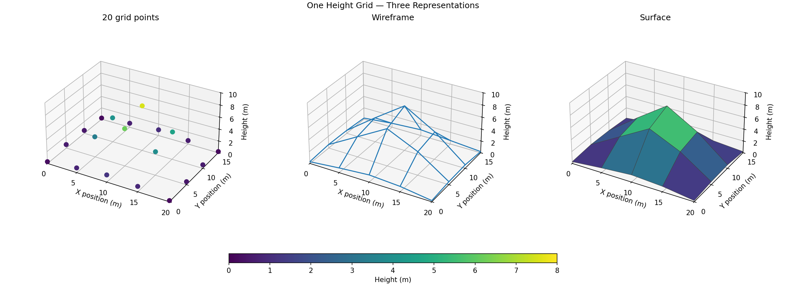
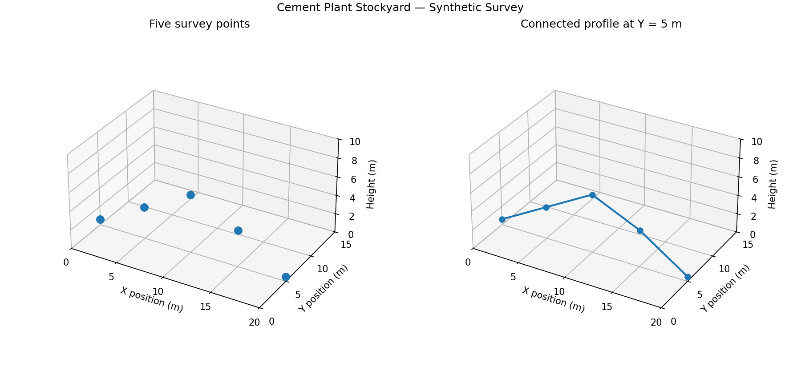
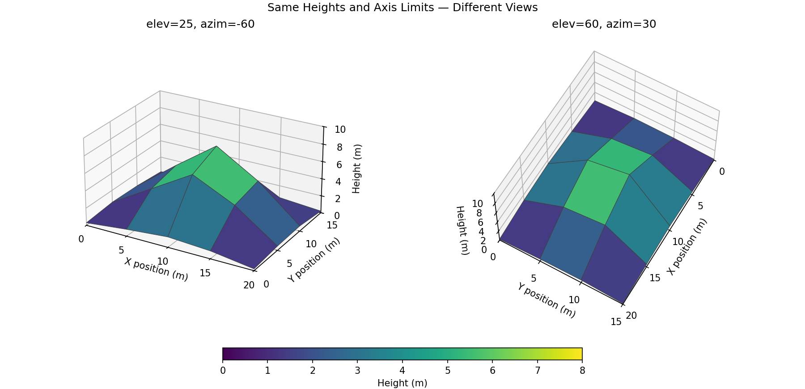
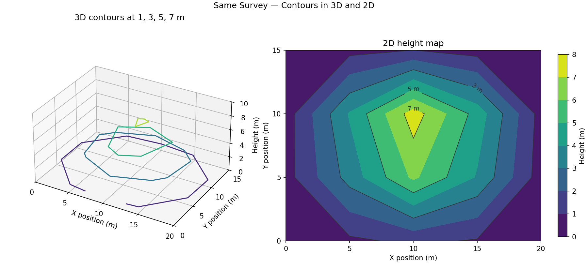
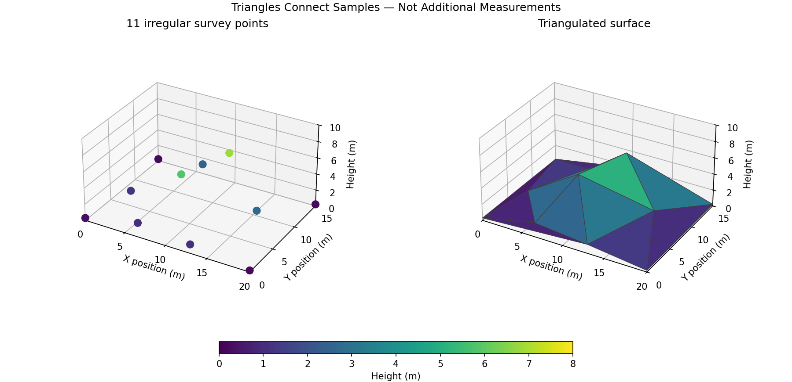

# EP12 — Three-Dimensional Plotting in Matplotlib

## การสำรวจความสูงกองวัสดุในโรงงานปูนซีเมนต์

จุดบนพื้นลานมีตำแหน่งสองค่า คือ X และ Y

เมื่อเพิ่มความสูงของวัสดุที่ตำแหน่งนั้น เราจะได้ข้อมูลสามค่า คือ X, Y และ Z

บทนี้ใช้ข้อมูลสมมติของกองวัสดุในลานโรงงานปูนซีเมนต์

เริ่มจากแนวสำรวจ 5 จุด แล้วขยายเป็นตารางความสูง 20 จุด

ไม่ต้องสร้างสมการจำลองหรือดาวน์โหลดชุดข้อมูลเพิ่มเติม

ทั้งสามกราฟใช้ตำแหน่งและความสูงชุดเดียวกัน

เส้นและผิวที่เชื่อมระหว่างจุดเป็นวิธีแสดงข้อมูล ไม่ใช่จุดวัดใหม่

ข้อมูลนี้ไม่ใช่ผลสำรวจจริง และไม่ใช้คำนวณปริมาตร สต็อกสินค้า หรือความปลอดภัยของกองวัสดุ

## สิ่งที่จะได้เรียนรู้

- สร้าง Axes สามมิติด้วย `projection="3d"`
- แสดงจุดและเส้นจากพิกัด X, Y, Z
- ใช้ `np.meshgrid()` จับคู่ตำแหน่งบนตาราง
- แสดง Wireframe, Surface และเส้นชั้นความสูง
- เปลี่ยนมุมมองโดยไม่แก้ข้อมูล
- เลือกภาพสองมิติเมื่อช่วยอ่านตำแหน่งได้ชัดกว่า

การสร้างผิวจากจุดที่ไม่เป็นตารางอยู่ในหัวข้อเสริมที่พับเก็บได้

## สิ่งที่ต้องเตรียม

ใช้ Python, NumPy และ Matplotlib

~~~bash
python -m pip install numpy matplotlib
~~~

ตัวอย่างทดสอบด้วย Python 3.13, NumPy 2.2.6 และ Matplotlib 3.10.3

ข้อความในกราฟใช้ภาษาอังกฤษ จึงไม่ต้องติดตั้งฟอนต์ภาษาไทยเพิ่ม

การใช้งานโค้ดในบท:

- รัน Import และข้อมูลในหัวข้อ 1 ก่อน
- หัวข้อ 2–4 ใช้ข้อมูลแนวสำรวจ 5 จุด
- รันข้อมูลตารางในหัวข้อ 5 ก่อนหัวข้อ 6–10
- หัวข้อ 11 มีข้อมูลแยกของตัวเอง
- กล่อง “โค้ดเต็ม” เปิดรันได้หลังเตรียมข้อมูลของส่วนนั้น
- สคริปต์ใน `source-code` รันแยกกันได้ตามคำสั่งท้ายบท

## 1. อ่านพิกัด X, Y และ Z

ในตัวอย่างนี้ ทั้งสามแกนใช้หน่วยเมตร

| ค่า | ความหมาย |
|---|---|
| X | ตำแหน่งตามแนวยาวของลาน |
| Y | ตำแหน่งตามแนวกว้างของลาน |
| Z | ความสูงของวัสดุเหนือระนาบอ้างอิงที่กำหนดเป็นศูนย์ |

จุด `(10, 5, 6.2)` หมายถึง:

- อยู่ที่ X = 10 เมตร
- อยู่ที่ Y = 5 เมตร
- มีความสูง Z = 6.2 เมตร

X และ Y ในบทนี้เป็นพิกัดท้องถิ่น ไม่ใช่ละติจูดและลองจิจูด

### ข้อมูลแนวสำรวจ 5 จุด

~~~python
import numpy as np
import matplotlib.pyplot as plt

plt.style.use("default")

x_points = np.array([0, 5, 10, 15, 20])
y_points = np.array([5, 5, 5, 5, 5])
height_points = np.array([0.6, 3.4, 6.2, 3.9, 0.5])
~~~

สมาชิกที่ตำแหน่งเดียวกันในทั้งสาม Array ประกอบกันเป็นหนึ่งจุด

เช่น สมาชิก index `2` คือ `(10, 5, 6.2)`

ทุกจุดมี Y = 5 จึงเป็นแนวสำรวจหนึ่งแนว ไม่ใช่ข้อมูลทั้งกองวัสดุ

`height_points` คือค่าที่จะใช้เป็นแกน Z

`plt.style.use("default")` คืนรูปลักษณ์เริ่มต้นสำหรับกราฟที่จะสร้างต่อไปใน Session นี้

## 2. สร้าง Axes สามมิติ

คำสั่งที่เพิ่มจากกราฟสองมิติคือ `projection="3d"`

~~~python
fig = plt.figure(figsize=(8, 5.5), layout="constrained")
ax = fig.add_subplot(projection="3d")

ax.set(
    title="Stockyard Coordinates",
    xlabel="X position (m)",
    ylabel="Y position (m)",
    zlabel="Height (m)",
    xlim=(0, 20),
    ylim=(0, 15),
    zlim=(0, 10),
)
ax.set_box_aspect((20, 15, 10), zoom=0.85)
plt.show()
~~~

ผลลัพธ์เป็นพื้นที่กราฟที่มีแกน X, Y และ Z แต่ยังไม่มีจุดข้อมูล

`fig` ยังเป็น Figure เหมือนตอนก่อนหน้า

ส่วน `ax` เป็น Axes แบบสามมิติ จึงรับพิกัด Z ได้ด้วย

`set_box_aspect((20, 15, 10))` กำหนดสัดส่วนกรอบกราฟให้ตรงกับช่วงแกนที่ตั้งไว้

ตัวอย่างนี้ใช้หน่วยเมตรทุกแกน จึงเลือกสัดส่วนตามช่วง X : Y : Z เท่ากับ 20 : 15 : 10

คำสั่งนี้ไม่เปลี่ยนค่าความสูงในข้อมูล และไม่ได้ทำให้ทุกแกนมีความยาวเท่ากันบนภาพ

`zoom=0.85` ย่อกรอบกราฟเล็กน้อยเพื่อเว้นที่ให้ชื่อแกน โดยยังคงสัดส่วนเดิม

หากเปลี่ยนช่วงแกน ต้องพิจารณาสัดส่วนกรอบใหม่ด้วย

รายละเอียด: [Axes3D.set_box_aspect](https://matplotlib.org/stable/api/_as_gen/mpl_toolkits.mplot3d.axes3d.Axes3D.set_box_aspect.html)

Matplotlib รุ่นปัจจุบันใช้งาน `projection="3d"` ได้โดยไม่ต้อง Import `Axes3D` แยก

ดูตัวอย่างใน [The mplot3d toolkit](https://matplotlib.org/stable/users/explain/toolkits/mplot3d.html)

## 3. แสดงจุดสำรวจด้วย Scatter

บน Axes สามมิติ `ax.scatter()` รับตำแหน่ง X, Y และ Z

คำสั่งวาดจุด:

~~~python
ax.scatter(x_points, y_points, height_points, s=65, color="tab:blue")
~~~

โค้ดเต็ม — จุดสำรวจ 5 จุด

~~~python
fig = plt.figure(figsize=(8, 5.5), layout="constrained")
ax = fig.add_subplot(projection="3d")

ax.scatter(
    x_points,
    y_points,
    height_points,
    s=65,
    color="tab:blue",
)
ax.set(
    title="Five Survey Points",
    xlabel="X position (m)",
    ylabel="Y position (m)",
    zlabel="Height (m)",
    xlim=(0, 20),
    ylim=(0, 15),
    zlim=(0, 10),
)
ax.set_box_aspect((20, 15, 10), zoom=0.85)
plt.show()
~~~

ผลที่ควรเห็นคือจุด 5 จุด โดยไม่มีเส้นเชื่อม

จุดสูงสุดของแนวนี้อยู่ที่ X = 10, Y = 5 และสูง 6.2 เมตร

`s` ปรับขนาด Marker ไม่ใช่ค่าความสูง

Scatter แบบสามมิติมีการปรับลักษณะสีตามความลึกโดยค่าเริ่มต้น

ถ้าต้องการให้สีจุดไม่ถูกปรับตามความลึก สามารถเพิ่ม `depthshade=False`

## 4. เชื่อมจุดเป็นแนวสำรวจ

ใช้ `ax.plot()` เมื่อต้องการเชื่อมจุดตามลำดับใน Array

~~~python
ax.plot(x_points, y_points, height_points, marker="o")
~~~

โค้ดเต็ม — แนวสำรวจที่ Y = 5 เมตร

~~~python
fig = plt.figure(figsize=(8, 5.5), layout="constrained")
ax = fig.add_subplot(projection="3d")

ax.plot(
    x_points,
    y_points,
    height_points,
    marker="o",
    linewidth=2,
    color="tab:blue",
)
ax.set(
    title="Survey Profile at Y = 5 m",
    xlabel="X position (m)",
    ylabel="Y position (m)",
    zlabel="Height (m)",
    xlim=(0, 20),
    ylim=(0, 15),
    zlim=(0, 10),
)
ax.set_box_aspect((20, 15, 10), zoom=0.85)
plt.show()
~~~

กราฟซ้ายแสดงจุดแยกกัน

กราฟขวาเชื่อมจุดตามลำดับ X จาก 0 ถึง 20

เส้นตรงระหว่างจุดช่วยแสดงแนวความสูง แต่ไม่ได้ยืนยันรูปร่างจริงระหว่างตำแหน่งวัด

ไม่ควรเชื่อมจุดที่เรียงลำดับแบบสุ่ม เพราะเส้นจะลากข้ามพื้นที่ตามลำดับใน Array

## 5. เตรียมตารางความสูงด้วย meshgrid

แนวสำรวจเดียวบอกความสูงเฉพาะที่ Y = 5

ข้อมูลชุดถัดไปมีแนวสำรวจ 4 แถว ครอบคลุม Y = 0, 5, 10 และ 15 เมตร

แต่ละแถวมีตำแหน่ง X จำนวน 5 ตำแหน่งเหมือนกัน

~~~python
x = np.array([0, 5, 10, 15, 20])
y = np.array([0, 5, 10, 15])

height = np.array([
    [0.3, 0.8, 1.2, 0.9, 0.2],
    [0.6, 3.4, 6.2, 3.9, 0.5],
    [0.5, 4.1, 7.5, 4.6, 0.6],
    [0.2, 0.7, 1.0, 0.6, 0.2],
])

X, Y = np.meshgrid(x, y)
~~~

ตารางความสูงมีหน่วยเมตร:

| Y / X | 0 | 5 | 10 | 15 | 20 |
|---|---:|---:|---:|---:|---:|
| 0 | 0.3 | 0.8 | 1.2 | 0.9 | 0.2 |
| 5 | 0.6 | 3.4 | 6.2 | 3.9 | 0.5 |
| 10 | 0.5 | 4.1 | 7.5 | 4.6 | 0.6 |
| 15 | 0.2 | 0.7 | 1.0 | 0.6 | 0.2 |

`height` มี 4 แถวและ 5 คอลัมน์

- แถวเลือกตำแหน่ง Y
- คอลัมน์เลือกตำแหน่ง X
- ค่าในช่องคือความสูง Z

แถวที่ index `1` ตรงกับแนว Y = 5 ที่ใช้ในหัวข้อก่อนหน้า

### meshgrid จัดตำแหน่ง ไม่ได้คำนวณความสูง

`np.meshgrid(x, y)` สร้างตารางพิกัด X และ Y ให้จับคู่กับแต่ละช่องของ `height`

~~~python
print("X:")
print(X)
print("Y:")
print(Y)
print(X.shape, Y.shape, height.shape)
~~~

ผลลัพธ์:

~~~text
X:
[[ 0  5 10 15 20]
 [ 0  5 10 15 20]
 [ 0  5 10 15 20]
 [ 0  5 10 15 20]]

Y:
[[ 0  0  0  0  0]
 [ 5  5  5  5  5]
 [10 10 10 10 10]
 [15 15 15 15 15]]

(4, 5) (4, 5) (4, 5)
~~~

ตัวอย่างหนึ่งช่อง:

~~~python
print(X[2, 2], Y[2, 2], height[2, 2])
# 10 10 7.5
~~~

ช่องนี้คือจุด X = 10, Y = 10 และ Z = 7.5 เมตร

`meshgrid()` ไม่ได้สร้างความสูงเพิ่ม และไม่ได้ทำให้ข้อมูลวัดละเอียดขึ้น

ตัวอย่างใช้รูปแบบเริ่มต้น `indexing="xy"` จึงไม่ต้องใส่ Parameter นี้

ดูรายละเอียดใน [NumPy meshgrid](https://numpy.org/doc/stable/reference/generated/numpy.meshgrid.html)

## 6. แสดงโครงตาข่ายด้วย Wireframe

`plot_wireframe()` เชื่อมจุดตามแถวและคอลัมน์ของตาราง

~~~python
ax.plot_wireframe(X, Y, height, color="tab:blue")
~~~

โค้ดเต็ม — โครงตาข่ายความสูง

~~~python
fig = plt.figure(figsize=(8, 5.5), layout="constrained")
ax = fig.add_subplot(projection="3d")

ax.plot_wireframe(
    X, Y, height,
    color="tab:blue",
    linewidth=1.4,
)
ax.set(
    title="Stockpile Wireframe",
    xlabel="X position (m)",
    ylabel="Y position (m)",
    zlabel="Height (m)",
    xlim=(0, 20),
    ylim=(0, 15),
    zlim=(0, 10),
)
ax.set_box_aspect((20, 15, 10), zoom=0.85)
plt.show()
~~~

ผลที่ควรเห็นคือโครงเส้นคล้ายตาข่ายที่ยกสูงบริเวณกลางลาน

Wireframe ช่วยให้เห็นทั้งรูปร่างและความห่างของตำแหน่งบนตาราง

ช่องว่างระหว่างเส้นไม่ได้หมายถึงข้อมูลสูญหาย แต่เป็นรูปแบบที่ไม่ได้เติมสีบนผิว

## 7. เติมผิวด้วย Surface และ Colorbar

`plot_surface()` ใช้ตารางเดียวกับ Wireframe แต่เติมผิวระหว่างจุด

~~~python
surface = ax.plot_surface(
    X, Y, height,
    cmap="viridis",
    vmin=0,
    vmax=8,
)
~~~

โค้ดเต็ม — ผิวความสูงพร้อม Colorbar

~~~python
fig = plt.figure(figsize=(9, 5.5), layout="constrained")
ax = fig.add_subplot(projection="3d")

surface = ax.plot_surface(
    X, Y, height,
    cmap="viridis",
    vmin=0,
    vmax=8,
    edgecolor="0.25",
    linewidth=0.5,
)
fig.colorbar(
    surface,
    ax=ax,
    shrink=0.65,
    pad=0.10,
    label="Height (m)",
)
ax.set(
    title="Stockpile Surface",
    xlabel="X position (m)",
    ylabel="Y position (m)",
    zlabel="Height (m)",
    xlim=(0, 20),
    ylim=(0, 15),
    zlim=(0, 10),
)
ax.set_box_aspect((20, 15, 10), zoom=0.85)
plt.show()
~~~

- ความสูงของผิวแสดงค่า Z
- สีของผิวใช้ความสูงเป็นข้อมูลอีกทางหนึ่ง ไม่ใช่ปริมาณวัสดุ
- `vmin=0, vmax=8` กำหนดช่วงสี ไม่ใช่ช่วงแกน Z
- `zlim=(0, 10)` กำหนดช่วงแกน Z
- `edgecolor` และ `linewidth` ทำให้เห็นขอบช่องของผิว
- `shrink` ย่อความยาว Colorbar เมื่อเทียบกับขนาดปกติ

Surface ในตัวอย่างมีข้อมูลเพียง 20 จุด จึงเห็นผิวเป็นเหลี่ยมได้

สีของแต่ละหน้าผิวอิงค่าความสูงของหน้าผิวนั้น จึงไม่ใช่การระบายสีแยกทุกจุดวัดเหมือน Scatter

การเพิ่มจำนวนช่องด้วยการประมาณค่าระหว่างจุด ไม่เท่ากับการมีข้อมูลสำรวจเพิ่ม

รายละเอียด: [Axes3D.plot_surface](https://matplotlib.org/stable/api/_as_gen/mpl_toolkits.mplot3d.axes3d.Axes3D.plot_surface.html)

## 8. เปลี่ยนมุมมองด้วย view_init

`view_init()` เปลี่ยนมุมที่มองกราฟ โดยไม่เปลี่ยนค่าพิกัด

~~~python
ax.view_init(elev=25, azim=-60)
~~~

- `elev` คือมุมเงยจากระนาบ X–Y
- `azim` คือมุมหมุนรอบแกน Z
- ทั้งสองค่าใช้หน่วยองศา

ตัวอย่างเปรียบเทียบมุมมอง:

โค้ดเต็ม — ข้อมูลเดิมในสองมุมมอง

~~~python
fig, axes = plt.subplots(
    1, 2,
    figsize=(12, 5.5),
    subplot_kw={"projection": "3d"},
    layout="constrained",
)

for ax, elev, azim in zip(axes, [25, 60], [-60, 30]):
    ax.plot_surface(
        X, Y, height,
        cmap="viridis",
        vmin=0,
        vmax=8,
        edgecolor="0.25",
        linewidth=0.5,
    )
    ax.set(
        title=f"elev={elev}, azim={azim}",
        xlabel="X position (m)",
        ylabel="Y position (m)",
        zlabel="Height (m)",
        xlim=(0, 20),
        ylim=(0, 15),
        zlim=(0, 10),
    )
    ax.set_box_aspect((20, 15, 10), zoom=0.85)
    ax.view_init(elev=elev, azim=azim)

plt.show()
~~~

มุมเงยที่มากขึ้นช่วยให้เห็นตำแหน่งบนพื้นลานมากขึ้น

การหมุนรอบแกน Z ช่วยดูอีกด้านของกองวัสดุ

ข้อมูลที่ถูกผิวด้านหน้าบังอาจมองเห็นได้เมื่อเปลี่ยนมุม

`subplot_kw={"projection": "3d"}` ทำให้ทั้งสองช่องเป็น Axes สามมิติ

รายละเอียด: [Axes3D.view_init](https://matplotlib.org/stable/api/_as_gen/mpl_toolkits.mplot3d.axes3d.Axes3D.view_init.html)

การหมุนกราฟด้วยเมาส์ใน Notebook และไฟล์ Python

รูป PNG และผลลัพธ์แบบ Inline เป็นภาพนิ่ง จึงลากหมุนไม่ได้

หน้าต่างกราฟจากสคริปต์ Python ที่ใช้ Interactive Backend รองรับการหมุนด้วยเมาส์

หากใช้ Jupyter สามารถติดตั้ง `ipympl` เพิ่ม แล้วเลือก `%matplotlib widget` ก่อนสร้างกราฟ

ความพร้อมใช้งานขึ้นอยู่กับ Notebook Frontend และ Backend ที่ติดตั้ง

บทนี้ใช้ `view_init()` ได้โดยไม่ต้องเปิดโหมด Interactive

อ่านเพิ่มเติม: [Matplotlib Backends](https://matplotlib.org/stable/users/explain/figure/backends.html)

## 9. แสดงเส้นชั้นความสูงในสามมิติ

เส้นชั้นความสูงเชื่อมตำแหน่งที่มีความสูงเท่ากันตามการประมาณค่าจากตาราง

ตัวอย่างเลือกระดับ 1, 3, 5 และ 7 เมตร

~~~python
ax.contour(
    X, Y, height,
    levels=[1, 3, 5, 7],
    cmap="viridis",
    vmin=0,
    vmax=8,
)
~~~

โค้ดเต็ม — เส้นชั้นความสูงแบบสามมิติ

~~~python
fig = plt.figure(figsize=(8, 5.5), layout="constrained")
ax = fig.add_subplot(projection="3d")

ax.contour(
    X, Y, height,
    levels=[1, 3, 5, 7],
    cmap="viridis",
    vmin=0,
    vmax=8,
)
ax.set(
    title="Height Contours at 1, 3, 5, 7 m",
    xlabel="X position (m)",
    ylabel="Y position (m)",
    zlabel="Height (m)",
    xlim=(0, 20),
    ylim=(0, 15),
    zlim=(0, 10),
)
ax.set_box_aspect((20, 15, 10), zoom=0.85)
plt.show()
~~~

ผลที่ควรเห็นคือเส้นแต่ละระดับวางอยู่ที่ความสูง Z ของตัวเอง

เส้นไม่จำเป็นต้องเป็นวงปิด หากระดับนั้นตัดผ่านขอบพื้นที่สำรวจ

`levels=[1, 3, 5, 7]` ระบุค่าความสูง ไม่ใช่ตำแหน่ง X หรือ Y

Contour ไม่ได้แสดงปริมาตรวัสดุ และไม่ใช่แนวการเคลื่อนที่ของเครื่องจักร

รายละเอียด: [Axes3D.contour](https://matplotlib.org/stable/api/_as_gen/mpl_toolkits.mplot3d.axes3d.Axes3D.contour.html)

## 10. เปรียบเทียบกับแผนที่ความสูงสองมิติ

กราฟสามมิติช่วยดูรูปร่างโดยรวม แต่ผิวด้านหน้าอาจบังด้านหลัง

ถ้าต้องการดูว่าบริเวณสูงอยู่ตรงไหนบนลาน ภาพสองมิติอาจอ่านได้ง่ายกว่า

~~~python
fig, ax = plt.subplots(figsize=(8, 5.5), layout="constrained")

filled = ax.contourf(
    X, Y, height,
    levels=np.arange(0, 9),
    cmap="viridis",
    vmin=0,
    vmax=8,
)
lines = ax.contour(
    X, Y, height,
    levels=[1, 3, 5, 7],
    colors="0.2",
    linewidths=0.8,
)
ax.clabel(lines, levels=[3, 5, 7], fmt="%g m")
fig.colorbar(filled, ax=ax, label="Height (m)")
ax.set(
    title="Stockpile Height Map",
    xlabel="X position (m)",
    ylabel="Y position (m)",
    xlim=(0, 20),
    ylim=(0, 15),
)
ax.set_aspect("equal")
plt.show()
~~~

ในกราฟสองมิติ แกน X และ Y ยังเป็นตำแหน่งบนพื้นลาน

ค่าความสูงอ่านจากสีและตัวเลขบนเส้น Contour แทนแกน Z

ตัวอย่างใส่ตัวเลขบนเส้นระดับ 3, 5 และ 7 เมตร ซึ่งอยู่ภายในภาพ

เส้นระดับ 1 เมตรยังแสดงอยู่ แต่ไม่ใส่ตัวเลขเพื่อหลีกเลี่ยงข้อความชิดขอบภาพ

`set_aspect("equal")` ทำให้ระยะหนึ่งเมตรบนแกน X และ Y มีสเกลเท่ากัน

คำสั่งนี้ใช้กับ Axes สองมิติในตัวอย่างนี้

การเปลี่ยนจาก 3D เป็น 2D ไม่ได้ลบค่าความสูงออกจากข้อมูล แต่เปลี่ยนวิธีนำเสนอ

## 11. ข้อมูลเสริม: จุดสำรวจที่ไม่เป็นตาราง

Surface จากจุดที่กระจายไม่สม่ำเสมอด้วย plot_trisurf()

ข้อมูลสำรวจบางชุดไม่ได้เรียงเป็นแถวและคอลัมน์ครบทุกตำแหน่ง

ตัวอย่างเสริมนี้ใช้ข้อมูลสมมติอีกชุดหนึ่ง ไม่ใช่การเพิ่มจุดลงในตารางเดิม

~~~python
sample_x = np.array([0, 6, 13, 20, 2, 9, 17, 0, 7, 12, 20])
sample_y = np.array([0, 1, 0, 0, 6, 5, 7, 15, 13, 10, 15])
sample_height = np.array([
    0.3, 1.0, 1.1, 0.2, 1.2, 5.8, 2.7, 0.2, 2.5, 6.8, 0.2,
])

fig = plt.figure(figsize=(9, 5.5), layout="constrained")
ax = fig.add_subplot(projection="3d")

surface = ax.plot_trisurf(
    sample_x,
    sample_y,
    sample_height,
    cmap="viridis",
    vmin=0,
    vmax=8,
    edgecolor="0.25",
    linewidth=0.6,
)
fig.colorbar(surface, ax=ax, shrink=0.65, pad=0.10, label="Height (m)")
ax.set(
    title="Irregular Survey — Triangulated Surface",
    xlabel="X position (m)",
    ylabel="Y position (m)",
    zlabel="Height (m)",
    xlim=(0, 20),
    ylim=(0, 15),
    zlim=(0, 10),
)
ax.set_box_aspect((20, 15, 10), zoom=0.85)
plt.show()
~~~

`plot_trisurf()` ใช้ Array หนึ่งมิติสามชุดที่มีจำนวนสมาชิกเท่ากัน

Matplotlib สร้างการเชื่อมต่อเป็นสามเหลี่ยมจากตำแหน่ง X และ Y แล้วใช้ค่าความสูงของแต่ละจุด

จึงไม่ต้องนำข้อมูลไป `reshape()` ให้เป็นตารางโดยพลการ

สำหรับตัวอย่างพื้นผิวความสูงนี้ ตำแหน่ง X, Y แต่ละคู่ควรมีค่าความสูงเดียว

การเชื่อมอัตโนมัติอาจพาดข้ามบริเวณที่ไม่ได้สำรวจหรือบริเวณที่เป็นรู

จึงต้องตรวจขอบเขตและการเชื่อมต่อก่อนตีความผิว โดยเฉพาะข้อมูลจริง

รายละเอียด: [Axes3D.plot_trisurf](https://matplotlib.org/stable/api/_as_gen/mpl_toolkits.mplot3d.axes3d.Axes3D.plot_trisurf.html)

## 12. บันทึกภาพและตรวจการแสดงผล

วางคำสั่งบันทึกก่อน `plt.show()` ในโค้ดเต็มของกราฟที่ต้องการ

~~~python
fig.savefig(
    "stockpile-3d.png",
    dpi=160,
)
~~~

ไฟล์นี้จะอยู่ใน Working Directory ปัจจุบัน

ตัวอย่างบันทึกพื้นที่ Figure ทั้งใบ เพื่อคงที่ว่างรอบชื่อแกนสามมิติ

ภาพที่บันทึกเป็นมุมมอง ณ เวลานั้น ไม่ใช่โมเดลสามมิติที่หมุนต่อได้

ตรวจภาพที่ขนาดใช้งานจริง:

- ชื่อแกน X, Y และ Z ไม่ถูกตัด
- หน่วยครบทั้งสามแกน
- มุมมองไม่บังตำแหน่งสำคัญ
- Colorbar ระบุว่าใช้แสดงความสูง
- การเปรียบเทียบหลายกราฟใช้ช่วงแกนและช่วงสีเดียวกัน
- สัดส่วนกรอบไม่ทำให้กองวัสดุดูสูงชันเกินข้อมูล

ข้อผิดพลาดที่พบบ่อย

- ไม่ใส่ `projection="3d"`: ได้ Axes สองมิติ ไม่ใช่พื้นที่สำหรับพิกัด X, Y, Z
- ส่ง Array คนละขนาด: จุดแต่ละจุดต้องมีพิกัดครบ และตาราง X, Y, Z ในตัวอย่าง Surface ต้องมี Shape ตรงกัน
- สลับแถวกับคอลัมน์: ตารางนี้ใช้แถวเป็น Y และคอลัมน์เป็น X
- เข้าใจว่า `meshgrid()` สร้างความสูง: ฟังก์ชันนี้จัดตารางพิกัดเท่านั้น
- เชื่อม Scatter เป็นเส้นโดยไม่ตรวจลำดับ: เส้นจะเดินตามลำดับ Array ไม่ได้หาเส้นทางสำรวจให้
- เข้าใจว่าผิวเรียบแปลว่าข้อมูลแม่นยำ: การเชื่อมผิวไม่เพิ่มข้อมูลวัด
- คาดว่ารูป PNG จะหมุนได้: ต้องใช้กราฟที่เปิดใน Interactive Backend
- คาดว่า 3D ดีกว่า 2D เสมอ: ใช้ภาพสองมิติร่วมด้วยเมื่อข้อมูลถูกบัง

mplot3d เหมาะกับภาพข้อมูลสามมิติพื้นฐาน แต่มีข้อจำกัดในการจัดลำดับการบังกันของวัตถุบางกรณี

ไม่ใช่เครื่องมือ CAD สำหรับตรวจรูปทรงทางวิศวกรรม

อ่านเพิ่มเติม: [mplot3d FAQ](https://matplotlib.org/stable/api/toolkits/mplot3d/faq.html)

## แบบฝึกหัด

[แบบฝึกหัด: การแสดงข้อมูลสำรวจกองวัสดุ](./exercises/exercise01.md)

## ไฟล์ตัวอย่างและวิธีรัน

| ไฟล์ | เนื้อหา |
|---|---|
| [stockpile_data.py](./source-code/stockpile_data.py) | ข้อมูลแนวสำรวจ ตารางความสูง และจุดแบบไม่เป็นตาราง |
| [plot_helpers.py](./source-code/plot_helpers.py) | ชื่อแกน ช่วงแกน สัดส่วน และมุมมองที่ใช้ร่วมกัน |
| [points_and_profile.py](./source-code/points_and_profile.py) | เปรียบเทียบจุดและเส้นจากแนวสำรวจเดียวกัน |
| [surface_views.py](./source-code/surface_views.py) | เปรียบเทียบ Scatter, Wireframe, Surface และมุมมอง |
| [contour_comparison.py](./source-code/contour_comparison.py) | Contour สามมิติและแผนที่ความสูงสองมิติ |
| [irregular_surface.py](./source-code/irregular_surface.py) | ตัวอย่างเสริมของ Triangulated Surface |
| [generate_lesson_figures.py](./source-code/generate_lesson_figures.py) | สร้างภาพ PNG ทั้ง 5 ภาพในบทนี้ |
| [test_examples.py](./tests/test_examples.py) | ทดสอบข้อมูล ตัวอย่าง และทรัพยากรใน README |

เมื่อ Terminal อยู่ที่โฟลเดอร์หลักของ Repository:

~~~bash
python ep12-three-dimensional-plotting/source-code/points_and_profile.py
python ep12-three-dimensional-plotting/source-code/surface_views.py
python ep12-three-dimensional-plotting/source-code/contour_comparison.py
python ep12-three-dimensional-plotting/source-code/irregular_surface.py
~~~

แต่ละคำสั่งเป็นสคริปต์แยกกัน

หากอยู่ในโฟลเดอร์ `ep12-three-dimensional-plotting/source-code` แล้ว ให้รันชื่อไฟล์ได้เลย เช่น:

~~~bash
python points_and_profile.py
~~~

สร้างภาพประกอบใหม่จากโฟลเดอร์หลัก:

~~~bash
python ep12-three-dimensional-plotting/source-code/generate_lesson_figures.py
~~~

สคริปต์สร้างโฟลเดอร์ปลายทางให้อัตโนมัติ และอ้างตำแหน่ง `assets/plots` จากไฟล์สคริปต์ ไม่ใช่ Working Directory

หากต้องการเก็บในโฟลเดอร์อื่น:

~~~bash
python ep12-three-dimensional-plotting/source-code/generate_lesson_figures.py --output-dir output/ep12
~~~

ทดสอบตัวอย่างจากโฟลเดอร์หลัก:

~~~bash
python -m unittest discover -s ep12-three-dimensional-plotting/tests -v
~~~

## สรุป

- Scatter แสดงพิกัดแต่ละจุด
- Line เชื่อมจุดตามลำดับ
- Wireframe แสดงโครงเส้นของตารางความสูง
- Surface เติมผิวระหว่างตำแหน่งบนตาราง
- Contour แสดงระดับความสูงที่เท่ากัน
- `view_init()` เปลี่ยนมุมมอง ไม่เปลี่ยนข้อมูล

กราฟสามมิติช่วยแสดงรูปร่าง แต่ต้องอ่านควบคู่กับหน่วย ช่วงแกน และความละเอียดของข้อมูล

## แหล่งอ้างอิง

ข้อมูล ตัวอย่าง ภาพประกอบ และคำอธิบายในบทนี้จัดทำใหม่สำหรับกรณีศึกษาลานกองวัสดุ

ใช้แหล่งต่อไปนี้ประกอบการศึกษาหัวข้อและตรวจการใช้งาน API:

- [Python Data Science Handbook — Three-Dimensional Plotting in Matplotlib](https://jakevdp.github.io/PythonDataScienceHandbook/04.12-three-dimensional-plotting.html)
- [Matplotlib — The mplot3d toolkit](https://matplotlib.org/stable/users/explain/toolkits/mplot3d.html)
- [NumPy — meshgrid](https://numpy.org/doc/stable/reference/generated/numpy.meshgrid.html)
- [Matplotlib — mplot3d FAQ](https://matplotlib.org/stable/api/toolkits/mplot3d/faq.html)

## ตอนก่อนหน้า

**EP11 — [Customizing Matplotlib: Configurations and Stylesheets](../ep11-configurations-and-stylesheets/README.md)**

## ตอนถัดไป

**EP13 — [Geographic Data with Basemap](../ep13-geographic-data-with-basemap/README.md)**
