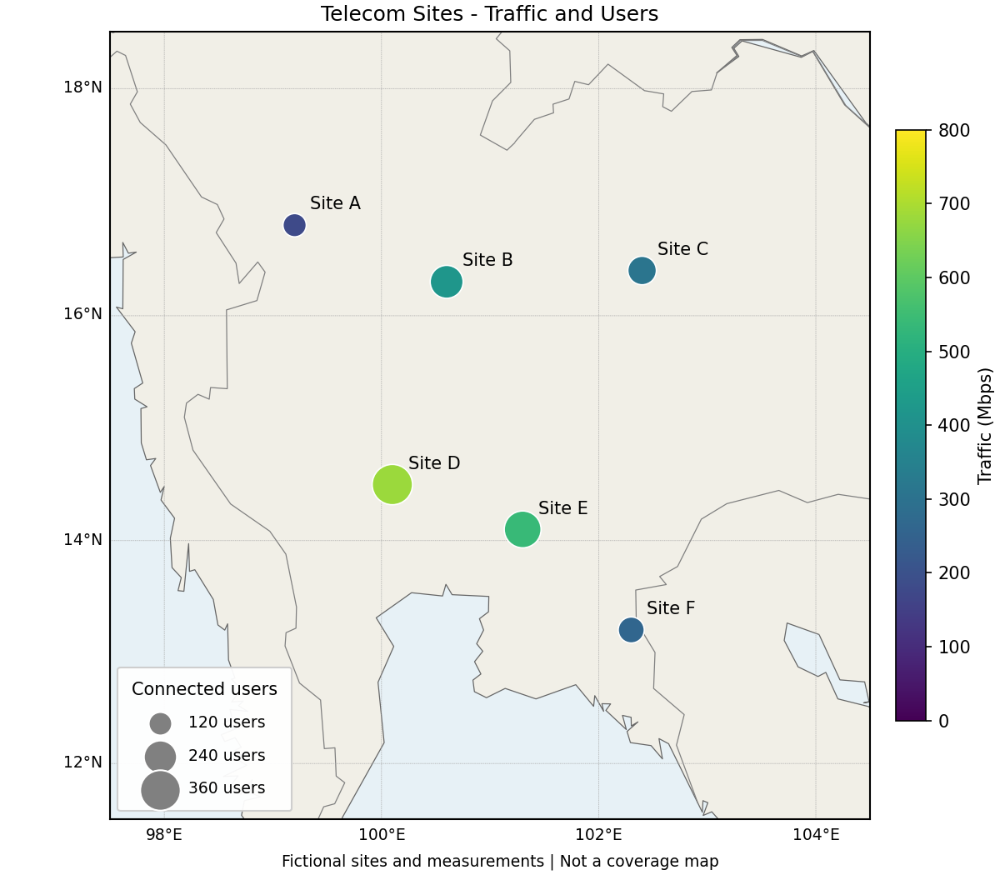
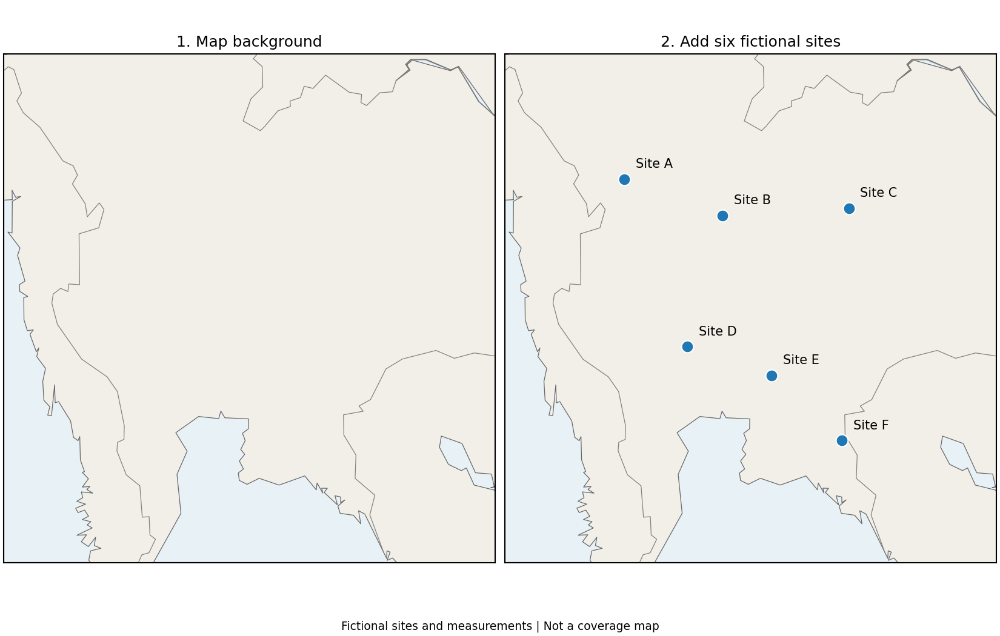
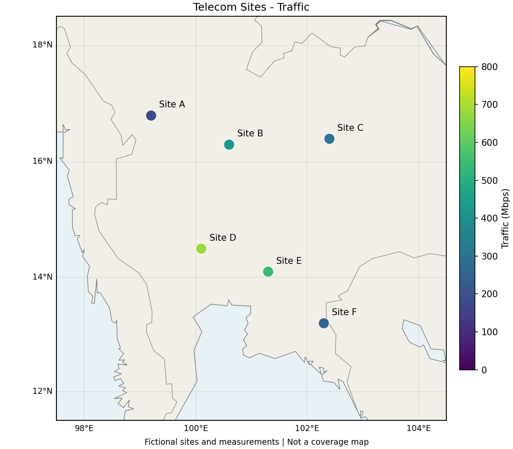
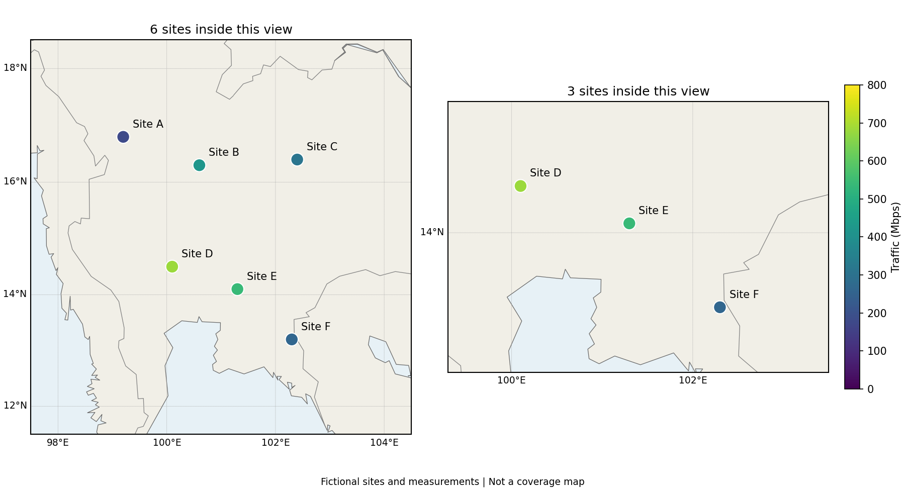

# EP13 — Geographic Data with Basemap

## แผนที่จุดให้บริการเครือข่ายโทรคมนาคม

ตารางข้อมูลบอกได้ว่าสถานีใดมีผู้ใช้งานมาก

แผนที่ช่วยให้เห็นเพิ่มว่าสถานีเหล่านั้นอยู่บริเวณใด

บทนี้ใช้สถานีสมมติ 6 จุดในบริเวณประเทศไทยและข้อมูลเครือข่ายหนึ่งช่วงเวลา

ไม่มีสมการจำลอง และไม่ต้องดาวน์โหลดชุดข้อมูลสถานีจากภายนอก

พิกัด ชื่อสถานี จำนวนผู้ใช้งาน และค่า Traffic เป็นข้อมูลสมมติทั้งหมด

วงกลมเป็นสัญลักษณ์ของสถานี ไม่ใช่พื้นที่ครอบคลุมสัญญาณ

เส้นชายฝั่งและพรมแดนเป็นข้อมูลพื้นหลังจากแพ็กเกจ Basemap ไม่ใช่ผลสำรวจของกรณีศึกษานี้

## สิ่งที่จะได้เรียนรู้

- อ่าน Longitude และ Latitude
- สร้างพื้นหลังแผนที่ด้วย Basemap
- แปลงพิกัดก่อนวางจุดและชื่อสถานี
- แสดงปริมาณข้อมูลด้วยสีและ Colorbar
- แสดงจำนวนผู้ใช้งานด้วยขนาดจุดและ Legend
- เปลี่ยนขอบเขตแผนที่โดยไม่แก้ข้อมูลต้นฉบับ

## สิ่งที่ต้องเตรียม

ใช้ Python, NumPy, Matplotlib และ Basemap

Basemap ต้องติดตั้งเพิ่ม แม้จะติดตั้ง Matplotlib ไว้แล้ว

เมื่อ Terminal อยู่ที่โฟลเดอร์หลักของ Repository:

~~~bash
python -m pip install -r ep13-geographic-data-with-basemap/requirements.txt
~~~

ไฟล์นี้กำหนด Basemap 2.0.0 และช่วงเวอร์ชันของ NumPy กับ Matplotlib ที่ใช้ร่วมกัน

ตัวอย่างทดสอบบน Windows ด้วย Python 3.13, Basemap 2.0.0, NumPy 2.3.5 และ Matplotlib 3.10.9

แนะนำให้ติดตั้งใน Virtual Environment แยกจากโปรเจกต์อื่น

การติดตั้งครั้งแรกต้องใช้อินเทอร์เน็ต แต่ตัวอย่างในบทไม่เรียกบริการแผนที่ออนไลน์ขณะรัน

Basemap ติดตั้ง `basemap-data` ซึ่งมีข้อมูลพื้นหลังพื้นฐานมาด้วย

ตัวอย่างใช้ `resolution="l"` จึงไม่ต้องติดตั้ง `basemap-data-hires`

ดูวิธีติดตั้งเพิ่มเติม: [Basemap — Installation](https://matplotlib.org/basemap/stable/users/installation.html)

ข้อความในกราฟใช้ภาษาอังกฤษ จึงไม่ต้องติดตั้งฟอนต์ภาษาไทยเพิ่ม

การใช้งานโค้ดในบท:

- รัน Import และข้อมูลในหัวข้อ 1 ก่อน
- รันฟังก์ชัน `make_map()` ในหัวข้อ 2
- หัวข้อ 4 เพิ่มฟังก์ชัน `label_sites()` และหัวข้อ 5 เพิ่ม `add_graticule()`
- ตัวอย่างถัดไปใช้ฟังก์ชันเหล่านี้ร่วมกัน
- กล่อง “โค้ดเต็ม” รันได้หลังเตรียมข้อมูลและฟังก์ชันตามลำดับ
- สคริปต์ใน `source-code` รันแยกกันได้ ตามคำสั่งท้ายบท

## 1. อ่านข้อมูลสถานีและพิกัด

พิกัดภูมิศาสตร์ในบทนี้ใช้หน่วยองศา

| ค่า | ความหมาย | ตัวอย่าง Site A |
|---|---|---|
| Longitude | ลองจิจูด ตำแหน่งทางตะวันออกหรือตะวันตกจากเส้นเมริเดียนแรก | 99.2°E |
| Latitude | ละติจูด ตำแหน่งทางเหนือหรือใต้จากเส้นศูนย์สูตร | 16.8°N |

ค่าบวกของ Longitude หมายถึงตะวันออก

ค่าบวกของ Latitude หมายถึงเหนือ

Basemap รับพิกัดตามลำดับ `(longitude, latitude)`

ดังนั้น Site A ใช้ `(99.2, 16.8)` ไม่ใช่ `(16.8, 99.2)`

~~~python
import numpy as np
import matplotlib.pyplot as plt
from mpl_toolkits.basemap import Basemap

site_names = np.array([
    "Site A", "Site B", "Site C",
    "Site D", "Site E", "Site F",
])

longitude = np.array([99.2, 100.6, 102.4, 100.1, 101.3, 102.3])
latitude = np.array([16.8, 16.3, 16.4, 14.5, 14.1, 13.2])

connected_users = np.array([120, 240, 180, 360, 300, 150])
traffic_mbps = np.array([180, 420, 310, 680, 540, 260])
~~~

สมาชิกตำแหน่งเดียวกันในแต่ละ Array เป็นข้อมูลของสถานีเดียวกัน

| สถานี | Longitude | Latitude | ผู้ใช้งานที่เชื่อมต่อ | Traffic (Mbps) |
|---|---:|---:|---:|---:|
| Site A | 99.2 | 16.8 | 120 | 180 |
| Site B | 100.6 | 16.3 | 240 | 420 |
| Site C | 102.4 | 16.4 | 180 | 310 |
| Site D | 100.1 | 14.5 | 360 | 680 |
| Site E | 101.3 | 14.1 | 300 | 540 |
| Site F | 102.3 | 13.2 | 150 | 260 |

Traffic ในตัวอย่างคืออัตราการรับส่งข้อมูลรวมของแต่ละสถานี มีหน่วยเมกะบิตต่อวินาที

ไม่ใช่ความเร็วของผู้ใช้งานแต่ละคน และไม่ใช่ความจุสูงสุดของสถานี

## 2. สร้างพื้นหลังแผนที่

`fig, ax` ยังเป็น Figure และ Axes ของ Matplotlib เหมือนบทก่อนหน้า

`Basemap(...)` กำหนดวิธีฉายแผนที่และขอบเขตภูมิศาสตร์ที่จะวาดลงใน `ax`

ฟังก์ชันต่อไปนี้รวมพื้นหลังที่ใช้ซ้ำในบท:

~~~python
def make_map(ax, west=97.5, east=104.5, south=11.5, north=18.5):
    m = Basemap(
        projection="merc",
        llcrnrlon=west,
        llcrnrlat=south,
        urcrnrlon=east,
        urcrnrlat=north,
        resolution="l",
        ax=ax,
    )
    m.drawmapboundary(fill_color="#e7f1f6")
    m.fillcontinents(color="#f1efe7", lake_color="#e7f1f6")
    m.drawcoastlines(color="0.4", linewidth=0.6)
    m.drawcountries(color="0.5", linewidth=0.6)
    return m

fig, ax = plt.subplots(figsize=(7, 7), layout="constrained")
m = make_map(ax)
ax.set_title("Map Background")
plt.show()
~~~

| Parameter | ความหมายในตัวอย่าง |
|---|---|
| `projection="merc"` | ใช้การฉายแผนที่แบบ Mercator |
| `llcrnrlon=west` | Longitude ของมุมซ้ายล่าง เท่ากับ 97.5 |
| `llcrnrlat=south` | Latitude ของมุมซ้ายล่าง เท่ากับ 11.5 |
| `urcrnrlon=east` | Longitude ของมุมขวาบน เท่ากับ 104.5 |
| `urcrnrlat=north` | Latitude ของมุมขวาบน เท่ากับ 18.5 |
| `resolution="l"` | ใช้รายละเอียดเส้นขอบระดับ Low |
| `ax=ax` | วาดแผนที่ลงใน Axes นี้ |

`llcrnr` ย่อจาก Lower Left Corner หรือมุมซ้ายล่าง

`urcrnr` ย่อจาก Upper Right Corner หรือมุมขวาบน

ส่วน `lon` และ `lat` หมายถึง Longitude และ Latitude

`drawmapboundary()` เติมสีพื้นและวาดขอบแผนที่

`fillcontinents()` เติมสีแผ่นดิน

`drawcoastlines()` วาดแนวชายฝั่ง

`drawcountries()` วาดเส้นพรมแดนประเทศ ไม่ใช่ขอบเขตจังหวัด

ตัวอักษร `l` ใน `resolution` เป็น L ตัวเล็ก ไม่ใช่เลข 1

ค่านี้ควบคุมรายละเอียดของเส้นขอบ ไม่ใช่ความคมชัดของไฟล์ PNG หรือความแม่นยำของพิกัดสถานี

## 3. แปลงพิกัดแล้ววางจุด

สำหรับแผนที่ Mercator นี้ ไม่ควรส่งค่าองศาเข้า `ax.scatter()` โดยตรง

ต้องแปลงเป็นพิกัด X และ Y ของแผนที่ก่อน:

~~~python
fig, ax = plt.subplots(figsize=(7, 7), layout="constrained")
m = make_map(ax)

# Longitude มาก่อน Latitude
x, y = m(longitude, latitude)

ax.scatter(
    x, y,
    s=90,
    color="tab:blue",
    edgecolors="white",
    zorder=4,
)

ax.set_title("Six Fictional Telecom Sites")
plt.show()
~~~

ลำดับการทำงานคือ:

~~~text
Longitude / Latitude หน่วยองศา
        ↓ m(longitude, latitude)
X / Y ในระบบพิกัดของแผนที่ Mercator นี้
        ↓ ax.scatter(x, y)
จุดสถานีบนแผนที่
~~~

`m` คือ Basemap Object ที่ได้จาก `make_map()`

การเขียน `m(...)` เรียกการแปลงพิกัดของ Object นี้ ไม่ใช่การคูณ

`zorder=4` ทำให้จุดอยู่เหนือชั้นพื้นหลังในตัวอย่าง

การแปลงนี้ไม่แก้ตัวเลขใน Array `longitude` และ `latitude`

รายละเอียดเพิ่มเติม: [Basemap — Converting map coordinates](https://matplotlib.org/basemap/stable/users/mapcoords.html)

## 4. ใส่ชื่อสถานี

ตำแหน่งชื่อสถานีต้องอ้างพิกัดแผนที่เดียวกับจุด

ใช้ `annotate()` จาก EP9 เลื่อนข้อความออกจากจุดเล็กน้อย:

~~~python
def label_sites(ax, m, names, longitude, latitude):
    x, y = m(longitude, latitude)
    for name, xi, yi in zip(names, x, y):
        ax.annotate(
            name,
            xy=(xi, yi),
            xytext=(9, 9),
            textcoords="offset points",
            fontsize=10,
            zorder=5,
        )

fig, ax = plt.subplots(figsize=(7, 7), layout="constrained")
m = make_map(ax)
x, y = m(longitude, latitude)
ax.scatter(x, y, s=90, color="tab:blue", edgecolors="white", zorder=4)
label_sites(ax, m, site_names, longitude, latitude)
ax.set_title("Telecom Site Locations")
plt.show()
~~~

`xy` ใช้พิกัดข้อมูลของ Axes ตามค่าเริ่มต้นของ `annotate()`

ในที่นี้พิกัดข้อมูลนั้นคือ X/Y ที่แปลงแล้ว ไม่ใช่ Longitude/Latitude

`xytext=(9, 9)` ร่วมกับ `textcoords="offset points"` เลื่อนข้อความไปทางขวา 9 points และขึ้น 9 points จากจุด

## 5. เพิ่มเส้น Latitude และ Longitude

เส้นอ้างอิงช่วยอ่านตำแหน่งโดยไม่ต้องแสดงค่า X/Y ของ Projection

~~~python
def add_graticule(m):
    m.drawparallels(
        [12, 14, 16, 18],
        labels=[1, 0, 0, 0],
        linewidth=0.4, color="0.65", fontsize=9,
    )
    m.drawmeridians(
        [98, 100, 102, 104],
        labels=[0, 0, 0, 1],
        linewidth=0.4, color="0.65", fontsize=9,
    )

fig, ax = plt.subplots(figsize=(7, 7), layout="constrained")
m = make_map(ax)
add_graticule(m)
x, y = m(longitude, latitude)
ax.scatter(x, y, s=90, color="tab:blue", edgecolors="white", zorder=4)
label_sites(ax, m, site_names, longitude, latitude)
ax.set_title("Latitude and Longitude")
plt.show()
~~~

`drawparallels()` วาดเส้น Latitude

`drawmeridians()` วาดเส้น Longitude

รายการ `labels` เรียงตาม `[ซ้าย, ขวา, บน, ล่าง]`

- `[1, 0, 0, 0]` แสดงข้อความเฉพาะด้านซ้าย
- `[0, 0, 0, 1]` แสดงข้อความเฉพาะด้านล่าง

เลข 1 และ 0 ใช้เปิดหรือปิดข้อความ ไม่ใช่ค่าพิกัด

เส้นอ้างอิงเหล่านี้เรียกว่า Graticule

ไม่ใช้ `ax.grid()` แทน เพราะกริดของ Axes ทั่วไปอ้าง X/Y ของแผนที่ ไม่ใช่องศา Latitude/Longitude โดยอัตโนมัติ

อ่านเพิ่มเติม: [Basemap — Drawing and Labelling Parallels and Meridians](https://matplotlib.org/basemap/stable/users/graticule.html)

## 6. ใช้สีแสดง Traffic

ตัวอย่างนี้ให้จุดทุกสถานีมีขนาดเท่ากันก่อน

สีเปลี่ยนตามค่า `traffic_mbps` ของแต่ละสถานี

~~~python
fig, ax = plt.subplots(figsize=(8, 7), layout="constrained")
m = make_map(ax)
add_graticule(m)

points = m.scatter(
    longitude, latitude,
    latlon=True,
    s=150,
    c=traffic_mbps,
    cmap="viridis",
    vmin=0, vmax=800,
    edgecolors="white",
    zorder=4,
)

label_sites(ax, m, site_names, longitude, latitude)
colorbar = fig.colorbar(points, ax=ax, shrink=0.75, pad=0.03)
colorbar.set_label("Traffic (Mbps)")
ax.set_title("Telecom Sites - Traffic")
plt.show()
~~~

`m.scatter(..., latlon=True)` รับ Longitude และ Latitude เป็นองศา แล้วแปลงพิกัดให้ภายใน

ยังคงส่ง Longitude ก่อน Latitude แม้ชื่อ Parameter จะเป็น `latlon`

จึงไม่ต้องเขียน `x, y = m(...)` ก่อนคำสั่ง Scatter แบบนี้

แต่ฟังก์ชัน `label_sites()` ยังแปลงพิกัดก่อนส่งให้ `ax.annotate()`

| รูปแบบ | ข้อมูลที่ส่งเข้า Scatter |
|---|---|
| `ax.scatter(x, y)` | X/Y ที่แปลงแล้ว |
| `m.scatter(longitude, latitude, latlon=True)` | Longitude/Latitude หน่วยองศา |

ไม่ส่ง X/Y ที่แปลงแล้วให้ `latlon=True` เพราะจะถูกตีความเป็นองศาซ้ำอีกครั้ง

`c=traffic_mbps` ใช้ค่าข้อมูลเลือกสี

`vmin=0, vmax=800` กำหนดช่วงสี ไม่แก้ค่าข้อมูล และไม่ได้กำหนดความจุของสถานี

`fig.colorbar(points, ...)` ใช้การจับคู่สีเดียวกับจุดบนแผนที่

Site D มีค่า Traffic มากที่สุดในชุดนี้ คือ 680 Mbps

ค่า Traffic สูงเพียงอย่างเดียวไม่ได้บอกว่าเครือข่ายขัดข้องหรือมีคุณภาพต่ำ

## 7. ใช้ขนาดจุดแสดงจำนวนผู้ใช้งาน

เพิ่มตัวแปรอีกหนึ่งตัวโดยให้พื้นที่ของวงกลมแปรตาม `connected_users`

~~~python
marker_sizes = connected_users * 1.5
~~~

Site A มี 120 users จึงได้ `s=180`

Site B มี 240 users จึงได้ `s=360`

พื้นที่วงกลมของ Site B เป็นสองเท่าของ Site A ไม่ใช่เส้นผ่านศูนย์กลางสองเท่า

`s` ของ Scatter มีหน่วย points²

ตัวคูณ 1.5 ใช้ปรับขนาดสัญลักษณ์ให้อ่านง่าย ไม่ใช่หน่วยระยะทางบนพื้นโลก

อ่านความหมาย Parameter: [Matplotlib — Axes.scatter](https://matplotlib.org/stable/api/_as_gen/matplotlib.axes.Axes.scatter.html)

โค้ดเต็ม: สีแทน Traffic และขนาดแทนจำนวนผู้ใช้งาน

~~~python
fig, ax = plt.subplots(figsize=(8, 7), layout="constrained")
m = make_map(ax)
add_graticule(m)

points = m.scatter(
    longitude, latitude,
    latlon=True,
    s=marker_sizes,
    c=traffic_mbps,
    cmap="viridis",
    vmin=0, vmax=800,
    edgecolors="white",
    linewidths=0.8,
    zorder=4,
)

label_sites(ax, m, site_names, longitude, latitude)
colorbar = fig.colorbar(points, ax=ax, shrink=0.75, pad=0.03)
colorbar.set_label("Traffic (Mbps)")

# จุดว่างใช้สร้างตัวอย่างขนาดใน Legend โดยไม่เพิ่มสถานีบนแผนที่
for users in [120, 240, 360]:
    ax.scatter(
        [], [],
        s=users * 1.5,
        color="0.5",
        edgecolors="white",
        label=f"{users} users",
    )

ax.legend(
    title="Connected users",
    loc="lower left",
    labelspacing=1.1,
    borderpad=0.9,
    fontsize=9,
    framealpha=0.95,
)

ax.set_title("Telecom Sites - Traffic and Users")
fig.supxlabel(
    "Fictional sites and measurements | Not a coverage map",
    fontsize=9,
)
plt.show()
~~~

Colorbar อธิบายความหมายของสี

Legend อธิบายความหมายของขนาด

ตัวอย่างใน Legend ใช้ตัวคูณ 1.5 เหมือนจุดจริง จึงเปรียบเทียบขนาดกันได้

วงกลมใหญ่ไม่ได้หมายความว่าสัญญาณไปได้ไกลกว่า และวงกลมทับกันไม่ได้แสดงว่าสัญญาณรบกวนกัน

## 8. เปลี่ยนขอบเขตแผนที่

ขอบเขตเริ่มต้นครอบคลุมทั้ง 6 สถานี

ถ้าใช้ Longitude 99.3–103.5 และ Latitude 12.5–15.4 จะเหลือ Site D, E และ F ในกรอบภาพ

เปลี่ยนขอบเขตตอนสร้าง Basemap ใหม่ ไม่ใช่เปลี่ยนตัวเลขในข้อมูลสถานี

ทั้งสองภาพใช้ช่วงสี 0–800 Mbps เหมือนกัน

Site D จึงยังมีสีเดียวกันแม้ขอบเขตแผนที่เปลี่ยนไป

โค้ดเต็ม: แสดงเฉพาะสถานีในขอบเขตใหม่

~~~python
west, east = 99.3, 103.5
south, north = 12.5, 15.4

# แต่ละตำแหน่งเป็น True เมื่อพิกัดอยู่ในกรอบทั้งสองแกน
visible = (
    (longitude >= west) & (longitude <= east)
    & (latitude >= south) & (latitude <= north)
)

fig, ax = plt.subplots(figsize=(8, 6), layout="constrained")
m = make_map(ax, west=west, east=east, south=south, north=north)
add_graticule(m)

points = m.scatter(
    longitude[visible], latitude[visible],
    latlon=True,
    s=150,
    c=traffic_mbps[visible],
    cmap="viridis",
    vmin=0, vmax=800,
    edgecolors="white",
    zorder=4,
)

label_sites(
    ax, m, site_names[visible],
    longitude[visible], latitude[visible],
)
colorbar = fig.colorbar(points, ax=ax, shrink=0.75, pad=0.03)
colorbar.set_label("Traffic (Mbps)")
ax.set_title("Sites D, E and F - Closer View")
plt.show()
~~~

`visible` เป็น Boolean Array สำหรับเลือกเฉพาะรายการที่อยู่ในกรอบ

การกรองช่วยไม่ให้ข้อความของสถานีที่อยู่นอกกรอบหลุดออกมาข้างภาพ

ข้อมูลต้นฉบับยังมีครบ 6 สถานี

## 9. ข้อมูลเสริม: Projection และข้อจำกัดของแผนที่

Projection คือวิธีแปลงตำแหน่งบนโลกมาเป็นตำแหน่งบนแผ่นภาพ

บทนี้ใช้ Mercator เพียงแบบเดียว เพื่อให้เปรียบเทียบตัวอย่างต่าง ๆ ได้ตรงกัน

Mercator ไม่รักษาขนาดพื้นที่หรือระยะทางจริงทุกตำแหน่ง และมีความบิดเบือนมากขึ้นใกล้ขั้วโลก

จึงไม่ใช้ระยะบนภาพหรือวงกลม Scatter คำนวณพื้นที่บริการของเครือข่าย

อ่านเพิ่มเติม: [Basemap — Mercator Projection](https://matplotlib.org/basemap/stable/users/merc.html)

พิกัดหลังแปลงและทางเลือกอื่น

สำหรับ `projection="merc"` ผล X/Y จาก `m(...)` อยู่ในหน่วยเมตรของระบบฉายแผนที่นี้

ไม่ใช่ระยะทางจริงจากกรุงเทพฯ หรือระยะทางเดินทางระหว่างสถานี

เมื่อขอบเขตหรือ Projection เปลี่ยน ต้องแปลงพิกัดด้วย Basemap Object ตัวใหม่

ไม่ควรนำ X/Y จากแผนที่เก่ามาใช้กับแผนที่ใหม่โดยตรง

ตัวอย่าง Projection อื่น:

| ค่า | ลักษณะ |
|---|---|
| `cyl` | วาง Longitude/Latitude บนกริดสี่เหลี่ยม ใน Basemap พิกัด X/Y เท่ากับค่าองศาที่ส่งเข้า |
| `lcc` | Lambert Conformal แบบกรวย มี Parameter ของการฉายที่ต้องเลือกให้เหมาะกับพื้นที่ |
| `ortho` | ภาพคล้ายมองโลกจากภายนอก เห็นเพียงด้านที่หันเข้าหาจุดมอง |

การเปลี่ยนชื่อ Projection อย่างเดียวอาจไม่พอ เพราะแต่ละแบบรับการกำหนดขอบเขตต่างกัน

บทนี้ยังไม่คำนวณระยะทาง ไม่วิเคราะห์สัญญาณ และไม่เชื่อมฐานข้อมูล GIS

## 10. บันทึกภาพและตรวจการแสดงผล

บันทึก Figure ล่าสุดได้ด้วย:

~~~python
from pathlib import Path

output_dir = Path("output")
output_dir.mkdir(parents=True, exist_ok=True)
fig.savefig(output_dir / "telecom-map.png", dpi=150)
~~~

คำสั่งนี้อ้างโฟลเดอร์ `output` จาก Working Directory ปัจจุบัน

`dpi` ควบคุมความละเอียดภาพที่บันทึก ไม่เพิ่มรายละเอียดชายฝั่งหรือเพิ่มความแม่นยำของข้อมูล

รายการตรวจผลลัพธ์:

- แผนที่รวมมีสถานีครบ 6 จุด และชื่อไม่ทับกัน
- Site D มี Traffic สูงสุด คือ 680 Mbps
- เมื่อใช้ขนาดแทนผู้ใช้งาน Site D มีวงกลมใหญ่สุด คือ 360 users
- เมื่อเปลี่ยนขอบเขตเหลือ Site D, E, F ค่าข้อมูลและช่วงสียังคงเดิม
- คำอธิบายสี ขนาด และหน่วยตรงกับข้อมูลที่แสดง

ปัญหาที่อาจพบ

- **`No module named 'mpl_toolkits.basemap'`**: ติดตั้ง Requirements ด้วย Python ตัวเดียวกับที่ใช้รันไฟล์ ถ้าใช้ Notebook ให้ตรวจ Kernel ด้วย
- **ติดตั้งแล้วเวอร์ชันไลบรารีชนกัน**: สร้าง Virtual Environment ใหม่ แล้วติดตั้งจาก `requirements.txt` ของบทนี้
- **จุดหายหรือไปอยู่ผิดตำแหน่ง**: ตรวจลำดับ Longitude/Latitude และอย่าส่ง X/Y ที่แปลงแล้วเข้า `latlon=True`
- **หาไฟล์ข้อมูลชายฝั่งไม่พบ**: ตรวจว่า `basemap-data` ติดตั้งสำเร็จ ตัวอย่างนี้ใช้ `resolution="l"` ไม่ต้องใช้ข้อมูล High Resolution
- **แผนที่ไม่มีตัวเลข X/Y แบบกราฟทั่วไป**: Basemap ซ่อน Tick เหล่านั้นตามค่าเริ่มต้น ใช้เส้น Latitude/Longitude ในหัวข้อ 5 แทน
- **เส้นชายฝั่งดูหยาบเมื่อขยาย**: `resolution="l"` มีรายละเอียดจำกัด การเพิ่ม DPI ไม่ทำให้เส้นขอบละเอียดขึ้น
- **เปิดรูปใน README ไม่ได้**: ตรวจว่าโฟลเดอร์ `assets/plots` มาครบ หรือรันตัวสร้างภาพตามคำสั่งด้านล่าง

## แบบฝึกหัด

[แบบฝึกหัด: แผนที่สถานีเครือข่ายโทรคมนาคม](./exercises/exercise01.md)

## ไฟล์ตัวอย่างและวิธีรัน

| ไฟล์ | เนื้อหา |
|---|---|
| [requirements.txt](./requirements.txt) | ไลบรารีสำหรับบทนี้ |
| [network_data.py](./source-code/network_data.py) | ข้อมูลสถานีสมมติ 6 จุด |
| [map_helpers.py](./source-code/map_helpers.py) | พื้นหลังแผนที่ เส้นพิกัด และชื่อสถานี |
| [site_locations.py](./source-code/site_locations.py) | เปรียบเทียบพื้นหลังกับแผนที่จุดสถานี |
| [network_report.py](./source-code/network_report.py) | แผนที่ Traffic และแผนที่สีร่วมกับขนาด |
| [map_extent.py](./source-code/map_extent.py) | เปรียบเทียบขอบเขตแผนที่สองขนาด |
| [generate_lesson_figures.py](./source-code/generate_lesson_figures.py) | สร้าง PNG ทั้ง 4 ภาพในบท |
| [test_examples.py](./tests/test_examples.py) | ทดสอบข้อมูล พิกัด โค้ดใน README และไฟล์ภาพ |

รันจากโฟลเดอร์หลักของ Repository:

~~~bash
python ep13-geographic-data-with-basemap/source-code/site_locations.py
python ep13-geographic-data-with-basemap/source-code/network_report.py
python ep13-geographic-data-with-basemap/source-code/map_extent.py
~~~

แต่ละคำสั่งเป็นสคริปต์แยกกัน

ถ้า Terminal อยู่ใน `ep13-geographic-data-with-basemap/source-code` แล้ว ให้รันชื่อไฟล์ได้เลย เช่น:

~~~bash
python network_report.py
~~~

สร้างภาพประกอบใหม่จากโฟลเดอร์หลัก:

~~~bash
python ep13-geographic-data-with-basemap/source-code/generate_lesson_figures.py
~~~

สคริปต์สร้าง `assets/plots` ให้ และอ้างตำแหน่งจากไฟล์สคริปต์ ไม่ใช่ Working Directory

หากต้องการเก็บในโฟลเดอร์อื่น:

~~~bash
python ep13-geographic-data-with-basemap/source-code/generate_lesson_figures.py --output-dir output/ep13
~~~

ทดสอบจากโฟลเดอร์หลัก:

~~~bash
python -m unittest discover -s ep13-geographic-data-with-basemap/tests -v
~~~

## สรุป

- Longitude/Latitude ระบุตำแหน่งทางภูมิศาสตร์
- Basemap วาดพื้นหลังและแปลงพิกัดให้เข้ากับแผนที่
- Scatter แสดงสถานี ส่วน Annotation แสดงชื่อ
- Colorbar อธิบายสี และ Legend อธิบายขนาดจุด
- ขอบเขตแผนที่เปลี่ยนส่วนที่มองเห็น ไม่เปลี่ยนค่าข้อมูล

## แหล่งอ้างอิง

ข้อมูลสถานี ตัวอย่างโค้ด ภาพ และคำอธิบายจัดทำใหม่สำหรับกรณีศึกษาโทรคมนาคม

ใช้หัวข้อจากหนังสือเป็นแนวทางประกอบการศึกษา และตรวจ API จากเอกสารของไลบรารี:

- [Python Data Science Handbook — Geographic Data with Basemap](https://jakevdp.github.io/PythonDataScienceHandbook/04.13-geographic-data-with-basemap.html)
- [Basemap — Installation](https://matplotlib.org/basemap/stable/users/installation.html)
- [Basemap — API](https://matplotlib.org/basemap/stable/api/basemap_api.html)
- [Basemap — Converting map coordinates](https://matplotlib.org/basemap/stable/users/mapcoords.html)
- [Basemap — Drawing and Labelling Parallels and Meridians](https://matplotlib.org/basemap/stable/users/graticule.html)
- [Basemap — Mercator Projection](https://matplotlib.org/basemap/stable/users/merc.html)
- [Matplotlib — Axes.scatter](https://matplotlib.org/stable/api/_as_gen/matplotlib.axes.Axes.scatter.html)

## ตอนก่อนหน้า

**EP12 — [Three-Dimensional Plotting in Matplotlib](../ep12-three-dimensional-plotting/README.md)**

## ตอนถัดไป

**EP14 — Data Visualization with Seaborn** (อยู่ในแผนเนื้อหา)
