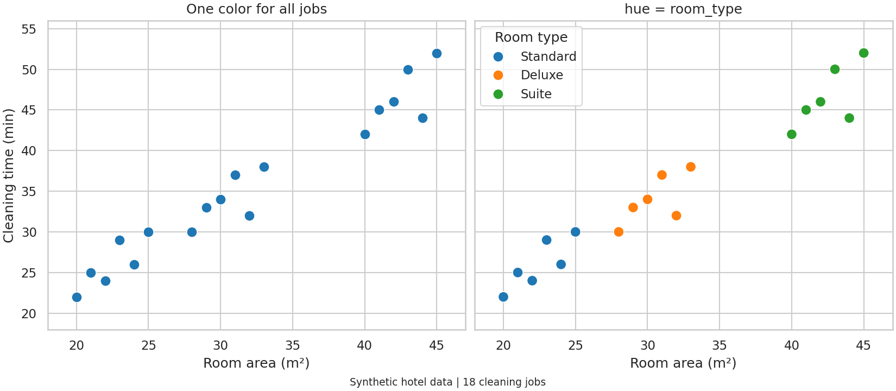
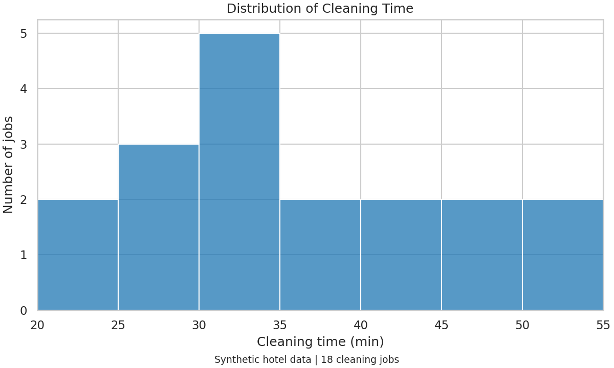
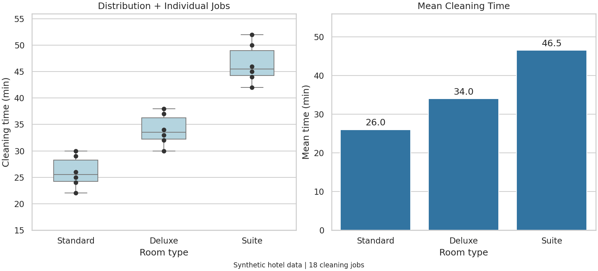
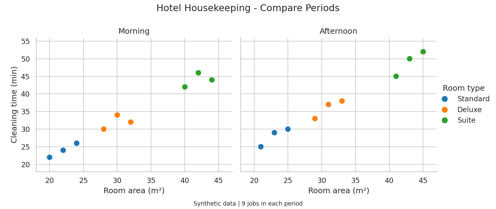
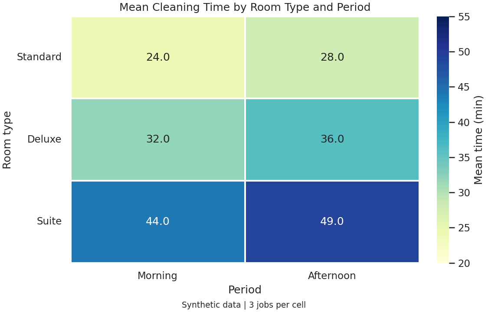
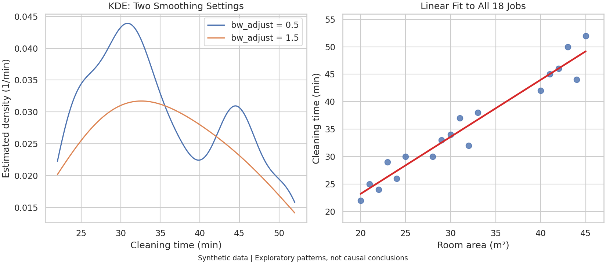
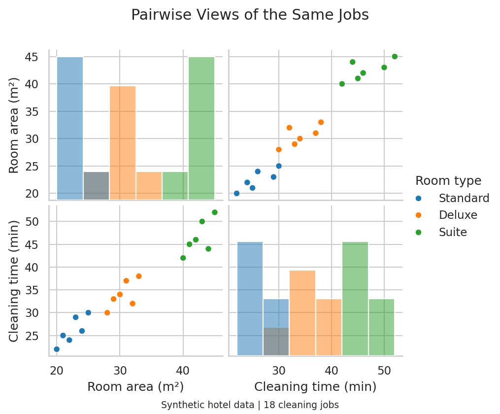

# EP14 — Visualization with Seaborn

## เปรียบเทียบงานทำความสะอาดห้องพักในโรงแรม

ห้องพักต่างประเภทใช้เวลาทำความสะอาดต่างกันอย่างไร?

พื้นที่ห้องสัมพันธ์กับเวลาที่ใช้หรือไม่?

บทนี้ใช้ข้อมูลสมมติ 18 รายการของงานทำความสะอาดห้องพักหลังเช็กเอาต์

มีห้อง Standard, Deluxe และ Suite อย่างละ 6 รายการ

เริ่มจากกราฟจุด แล้วใช้ข้อมูลชุดเดิมสร้างกราฟการกระจาย กราฟเปรียบเทียบกลุ่ม และ Heatmap

ข้อมูลนี้จัดทำเพื่อเรียนรู้การสร้างกราฟ ไม่ใช่ข้อมูลโรงแรมจริงหรือมาตรฐานเวลาทำงาน

ไม่ใช้ตัวเลขตัวอย่างประเมินประสิทธิภาพพนักงาน เพราะยังไม่มีข้อมูลสภาพห้อง จำนวนคนทำงาน หรือรายละเอียดงานแต่ละรายการ

## สิ่งที่จะได้เรียนรู้

- ใช้ชื่อคอลัมน์ใน DataFrame ระบุข้อมูลให้ Seaborn
- ใช้ Seaborn ร่วมกับ Figure และ Axes ของ Matplotlib
- แบ่งสีด้วย `hue` และกำหนดสีให้แต่ละกลุ่ม
- อ่าน Histogram, Box Plot และจุดข้อมูลรายรายการ
- แยกความหมายของค่าเฉลี่ยกับจำนวนรายการ
- แบ่งกราฟเป็นหลายช่องด้วย `relplot()`
- สร้าง Heatmap จากตารางสรุป

KDE, Regression และ Pair Plot อยู่ในหัวข้อเสริมที่พับเก็บได้

## สิ่งที่ต้องเตรียม

ใช้ Python, Pandas, Matplotlib และ Seaborn

NumPy เป็นหนึ่งในไลบรารีที่ Seaborn ใช้เบื้องหลัง ส่วนตัวอย่างเสริม KDE ใช้ SciPy

ติดตั้งจากโฟลเดอร์หลักของ Repository:

~~~bash
python -m pip install -r ep14-visualization-with-seaborn/requirements.txt
~~~

ตัวอย่างทดสอบด้วย Python 3.13, Seaborn 0.13.2, Pandas 2.3.2, NumPy 2.2.6, Matplotlib 3.10.3 และ SciPy 1.16.1

ใช้ Virtual Environment แยกจากโปรเจกต์อื่นได้เพื่อแยกเวอร์ชันไลบรารี

ตัวอย่างสร้างข้อมูลเอง ไม่ใช้ `sns.load_dataset()` และไม่เรียกบริการออนไลน์ขณะรัน

ข้อความในกราฟใช้ภาษาอังกฤษ จึงไม่ต้องติดตั้งฟอนต์ภาษาไทยเพิ่มเติม

วิธีใช้โค้ดในบท:

- รันข้อมูลและ Import ในหัวข้อ 1 ก่อน
- รัน `sns.set_theme()` ในหัวข้อ 2 ก่อนสร้างกราฟ
- รัน `room_order` และ `room_palette` ในหัวข้อ 3 ก่อนตัวอย่างถัดไป
- หัวข้อ 4–8 ใช้ข้อมูลชุดเดิม ไม่ต้องสร้างใหม่
- สคริปต์ใน `source-code` รันแยกกันได้ตามคำสั่งท้ายบท

## 1. เตรียมข้อมูลเป็น DataFrame

DataFrame เป็นตารางข้อมูลของ Pandas มีแถวและคอลัมน์

ในบทนี้ หนึ่งแถวหมายถึงงานทำความสะอาดห้องพักหนึ่งรายการ

| คอลัมน์ | ความหมาย |
|---|---|
| `room_type` | ประเภทห้อง: Standard, Deluxe หรือ Suite |
| `period` | ช่วงเวลาที่เริ่มงาน: Morning หรือ Afternoon |
| `area_m2` | พื้นที่ห้อง หน่วยตารางเมตร |
| `cleaning_min` | เวลาที่ใช้ทำความสะอาด หน่วยนาที |

~~~python
import pandas as pd
import matplotlib.pyplot as plt
import seaborn as sns

records = [
    ("Standard", "Morning", 20, 22),
    ("Standard", "Morning", 22, 24),
    ("Standard", "Morning", 24, 26),
    ("Standard", "Afternoon", 21, 25),
    ("Standard", "Afternoon", 23, 29),
    ("Standard", "Afternoon", 25, 30),
    ("Deluxe", "Morning", 28, 30),
    ("Deluxe", "Morning", 30, 34),
    ("Deluxe", "Morning", 32, 32),
    ("Deluxe", "Afternoon", 29, 33),
    ("Deluxe", "Afternoon", 31, 37),
    ("Deluxe", "Afternoon", 33, 38),
    ("Suite", "Morning", 40, 42),
    ("Suite", "Morning", 42, 46),
    ("Suite", "Morning", 44, 44),
    ("Suite", "Afternoon", 41, 45),
    ("Suite", "Afternoon", 43, 50),
    ("Suite", "Afternoon", 45, 52),
]

jobs = pd.DataFrame(
    records,
    columns=["room_type", "period", "area_m2", "cleaning_min"],
)

print(jobs.head())
print(jobs.shape)
~~~

`records` เป็น List ที่มี Tuple อยู่ข้างใน

แต่ละ Tuple คือข้อมูลหนึ่งแถว ส่วน `columns` กำหนดชื่อคอลัมน์ตามลำดับ

เช่น `("Standard", "Morning", 20, 22)` หมายถึงห้อง Standard พื้นที่ 20 ตารางเมตร เริ่มทำงานช่วงเช้า และใช้เวลา 22 นาที

`jobs.shape` ได้ `(18, 4)` คือ 18 แถว และ 4 คอลัมน์

การจัดข้อมูลแบบหนึ่งแถวต่อหนึ่งรายการ และหนึ่งคอลัมน์ต่อหนึ่งตัวแปร เป็นรูปแบบ Long-form ที่ใช้กับตัวอย่างในบทนี้

## 2. สร้างกราฟแรกด้วย Seaborn และ Matplotlib

Seaborn สร้างกราฟโดยใช้ Matplotlib เบื้องหลัง

เรายังสร้าง `fig, ax` และปรับชื่อกราฟด้วย `ax.set()` ได้เหมือนเดิม

~~~python
sns.set_theme(style="whitegrid")

fig, ax = plt.subplots(figsize=(8, 5), layout="constrained")

sns.scatterplot(
    data=jobs,
    x="area_m2",
    y="cleaning_min",
    color="tab:blue",
    s=85,
    ax=ax,
)

ax.set(
    title="Room Area and Cleaning Time",
    xlabel="Room area (m²)",
    ylabel="Cleaning time (min)",
)
plt.show()
~~~

`data=jobs` ระบุตารางที่จะใช้

`x="area_m2"` เลือกคอลัมน์พื้นที่ห้องเป็นแกน X

`y="cleaning_min"` เลือกคอลัมน์เวลาทำความสะอาดเป็นแกน Y

ข้อความใน `x` และ `y` เป็นชื่อคอลัมน์ ไม่ใช่ชื่อแกนที่แสดงบนภาพ

`ax=ax` บอกให้ Seaborn วาดลงใน Axes ที่เราสร้างไว้

หนึ่งจุดแทนหนึ่งงานทำความสะอาด รวมทั้งหมด 18 จุด

`sns.set_theme(style="whitegrid")` กำหนดธีมพื้นขาวพร้อมเส้นกริด

คำสั่งนี้เปลี่ยนค่าเริ่มต้นของ Matplotlib ใน Python Session ปัจจุบันด้วย ไม่ได้จำกัดเฉพาะกราฟ Seaborn

ถ้าต้องการให้ธีมมีผลชั่วคราว ใช้ร่วมกับ `plt.rc_context()` จาก EP11 ได้

## 3. แบ่งกลุ่มด้วย hue และกำหนดสีด้วย palette

กราฟเดิมยังไม่แยกว่าจุดใดเป็นห้องประเภทไหน

เพิ่ม `hue="room_type"` เพื่อใช้ประเภทห้องเลือกสี

~~~python
room_order = ["Standard", "Deluxe", "Suite"]
room_palette = {
    "Standard": "tab:blue",
    "Deluxe": "tab:orange",
    "Suite": "tab:green",
}

fig, ax = plt.subplots(figsize=(8, 5), layout="constrained")
sns.scatterplot(
    data=jobs,
    x="area_m2",
    y="cleaning_min",
    hue="room_type",
    hue_order=room_order,
    palette=room_palette,
    s=85,
    ax=ax,
)

ax.set(
    title="Cleaning Jobs by Room Type",
    xlabel="Room area (m²)",
    ylabel="Cleaning time (min)",
)
ax.legend(title="Room type")
plt.show()
~~~

`hue` อ่านว่า “ฮิว” ในตัวอย่างนี้หมายถึงตัวแปรที่ใช้แบ่งสี

`palette` กำหนดว่าประเภทห้องแต่ละประเภทใช้สีอะไร

`hue_order` กำหนดลำดับกลุ่มใน Legend

การใช้ Dictionary จับคู่ชื่อกลุ่มกับสี ช่วยให้ Standard ยังคงเป็นสีน้ำเงินในกราฟถัดไป

Seaborn สร้าง Legend ของกลุ่มให้ เราใช้ `ax.legend()` เปลี่ยนชื่อหัวข้อเป็นข้อความอ่านง่าย

ทั้งตำแหน่งและจำนวนจุดยังเหมือนเดิม มีเพียงสีที่ช่วยแยกประเภทห้อง

ข้อมูลตัวอย่างมีแนวโน้มว่าห้องใหญ่ใช้เวลามากกว่า แต่กราฟนี้ยังไม่พิสูจน์ว่าพื้นที่ห้องเป็นสาเหตุเพียงอย่างเดียว

## 4. ดูการกระจายด้วย Histogram

Histogram ตอบคำถามว่า เวลาทำความสะอาดส่วนใหญ่อยู่ในช่วงไหน

~~~python
time_bins = [20, 25, 30, 35, 40, 45, 50, 55]

fig, ax = plt.subplots(figsize=(8, 4.8), layout="constrained")
sns.histplot(
    data=jobs,
    x="cleaning_min",
    bins=time_bins,
    color="tab:blue",
    edgecolor="white",
    ax=ax,
)

ax.set(
    title="Distribution of Cleaning Time",
    xlabel="Cleaning time (min)",
    ylabel="Number of jobs",
    xticks=time_bins,
)
plt.show()
~~~

`bins` ในตัวอย่างเป็นรายการขอบช่วง ไม่ใช่จำนวนแท่ง

ขอบ 8 ค่า แบ่งข้อมูลออกเป็น 7 ช่วง ช่วงละ 5 นาที

เช่น ช่วง 20–น้อยกว่า 25 นาที มีข้อมูล 22 และ 24 จึงได้ความสูงแท่งเท่ากับ 2

ค่า 25 อยู่ในช่วงถัดไป ส่วนช่วงสุดท้ายรวมขอบขวาสุดด้วย

`histplot()` ใช้จำนวนรายการ หรือ `stat="count"` เป็นค่าเริ่มต้น จึงไม่ต้องระบุซ้ำ

ความสูงแท่งเป็นจำนวนงาน ไม่ใช่เวลาเฉลี่ย

การเปลี่ยนขอบช่วงทำให้รูปร่าง Histogram เปลี่ยนได้ แม้ข้อมูลเดิมไม่เปลี่ยน

## 5. เปรียบเทียบประเภทห้องด้วย Box Plot และจุดข้อมูล

Box Plot สรุปการกระจายของเวลาแยกตามประเภทห้อง

ใช้ `stripplot()` วางจุดข้อมูลแต่ละรายการทับลงไป เพื่อให้เห็นข้อมูลจริงที่ใช้สรุป

~~~python
fig, ax = plt.subplots(figsize=(8, 5), layout="constrained")

sns.boxplot(
    data=jobs,
    x="room_type", y="cleaning_min",
    order=room_order,
    color="lightblue",
    width=0.5,
    ax=ax,
)
sns.stripplot(
    data=jobs,
    x="room_type", y="cleaning_min",
    order=room_order,
    color="0.2",
    jitter=False,
    size=6,
    ax=ax,
)

ax.set(
    title="Cleaning Time by Room Type",
    xlabel="Room type",
    ylabel="Cleaning time (min)",
)
plt.show()
~~~

เส้นกลางกล่องคือ Median หรือค่ามัธยฐาน ไม่ใช่ค่าเฉลี่ย

ขอบล่างและขอบบนของกล่องคือควอไทล์ที่ 1 และ 3 หรือช่วงกึ่งกลางประมาณ 50% ของข้อมูล

ความสูงของกล่องจึงสื่อถึงการกระจายของเวลา ไม่ใช่จำนวนห้อง

จุดสีเข้มจาก `stripplot()` แสดงงานแต่ละรายการ มีประเภทละ 6 จุด

`jitter=False` ทำให้จุดอยู่ตรงกลางประเภทห้อง โดยไม่สุ่มเลื่อนในแนวนอน

ข้อมูลชุดนี้ไม่มีค่าเวลาซ้ำภายในประเภทห้องเดียวกัน จึงยังเห็นจุดได้ครบ

ความหมายของเส้นหนวดและจุดที่อยู่นอกหนวด

IQR คือระยะจากควอไทล์ที่ 1 ถึงควอไทล์ที่ 3

ตามค่าเริ่มต้น หนวดจะไปถึงจุดข้อมูลที่ไกลที่สุดซึ่งยังอยู่ภายในเกณฑ์ 1.5 เท่าของ IQR จากขอบกล่อง

หนวดจึงไม่จำเป็นต้องจบที่ค่าต่ำสุดและสูงสุดของข้อมูลทั้งหมด

ค่าที่เกินเกณฑ์จะแสดงเป็นจุดแยกของ Box Plot แต่ไม่ได้แปลว่าข้อมูลผิดหรือจำเป็นต้องลบทิ้ง

ข้อมูลเดิมในบทนี้ไม่มีจุดที่เกินเกณฑ์ดังกล่าว

ถ้าเพิ่มข้อมูลจนเกิดจุดนอกหนวด จุดนั้นอาจปรากฏทั้งจาก Box Plot และจาก Strip Plot ที่วางทับ

ใช้ `showfliers=False` กับ Box Plot ได้ในกรณีนั้น โดย Strip Plot ยังแสดงข้อมูลทุกจุดอยู่

## 6. แสดงค่าเฉลี่ยด้วย Bar Plot

เปลี่ยนคำถามจาก “ข้อมูลกระจายอย่างไร” เป็น “แต่ละประเภทใช้เวลาเฉลี่ยเท่าไร”

~~~python
fig, ax = plt.subplots(figsize=(8, 5), layout="constrained")
sns.barplot(
    data=jobs,
    x="room_type", y="cleaning_min",
    order=room_order,
    errorbar=None,
    color="tab:blue",
    ax=ax,
)

ax.set(
    title="Mean Cleaning Time",
    xlabel="Room type",
    ylabel="Mean time (min)",
    ylim=(0, 56),
)
ax.bar_label(ax.containers[0], fmt="%.1f", padding=3)
plt.show()
~~~

`barplot()` รวมข้อมูลในแต่ละกลุ่ม และคำนวณค่าเฉลี่ยตามค่าเริ่มต้น `estimator="mean"`

จึงไม่ต้องคำนวณค่าเฉลี่ยก่อนส่งข้อมูลเข้าไป และไม่ต้องใส่ `estimator` ซ้ำในตัวอย่างนี้

| ประเภทห้อง | จำนวนงาน | เวลาเฉลี่ย |
|---|---:|---:|
| Standard | 6 | 26.0 นาที |
| Deluxe | 6 | 34.0 นาที |
| Suite | 6 | 46.5 นาที |

`errorbar=None` ปิดการแสดงช่วงความไม่แน่นอนของค่าประมาณ ซึ่งปกติ Bar Plot จะแสดงด้วย

การซ่อน Error Bar ไม่ได้หมายความว่าข้อมูลทุกงานเท่ากัน หรือค่าเฉลี่ยไม่มีความไม่แน่นอน

`ax.bar_label()` ใส่ค่าของแต่ละแท่ง ส่วน `fmt="%.1f"` แสดงทศนิยมหนึ่งตำแหน่ง

ซ้ายแสดงการกระจายและแต่ละรายการ ขวาย่อแต่ละกลุ่มเป็นค่าเฉลี่ยหนึ่งค่า

แกนตั้งด้านขวาเริ่มที่ศูนย์ เพราะความยาวแท่งใช้สื่อขนาดของค่าเฉลี่ย

ถ้าต้องการนับจำนวนงานแยกตามประเภทห้อง ให้ใช้ `sns.countplot(data=jobs, x="room_type")` แทน

## 7. แบ่งกราฟตามช่วงเวลาด้วย relplot

`hue` แยกกลุ่มด้วยสีภายในกราฟเดียว

`col` แยกข้อมูลเป็นคนละช่องกราฟ

ตัวอย่างนี้ใช้สีแทนประเภทห้อง และใช้ช่องกราฟแยก Morning กับ Afternoon

~~~python
g = sns.relplot(
    data=jobs,
    x="area_m2", y="cleaning_min",
    hue="room_type",
    hue_order=room_order,
    palette=room_palette,
    col="period",
    col_order=["Morning", "Afternoon"],
    kind="scatter",
    s=85,
    height=4.5,
    aspect=1.05,
)

g.set_axis_labels("Room area (m²)", "Cleaning time (min)")
g.set_titles("{col_name}")
g.set(xlim=(18, 47), ylim=(18, 56))
g.legend.set_title("Room type")
g.figure.subplots_adjust(top=0.82, bottom=0.18)
g.figure.suptitle("Hotel Housekeeping - Compare Periods", y=0.98)
g.figure.supxlabel("Synthetic data | 9 jobs in each period", fontsize=9)
plt.show()
~~~

แต่ละช่องมี 9 จุด และใช้ช่วงแกนเดียวกันเพื่อเปรียบเทียบตำแหน่งได้ตรงกัน

`relplot()` เป็น Figure-level Function จึงสร้าง Figure และจัดช่องกราฟให้เอง

ไม่ต้องสร้าง `plt.subplots()` ก่อน และไม่ส่ง `ax=` ให้ `relplot()`

ตัวแปร `g` เป็น FacetGrid ไม่ใช่ Axes

เข้าถึง Figure ของมันได้ผ่าน `g.figure`

| รูปแบบ | ตัวอย่าง | วิธีจัดวาง |
|---|---|---|
| Axes-level | `scatterplot()`, `histplot()`, `boxplot()` | วาดลงใน `ax` ที่กำหนดได้ |
| Figure-level | `relplot()`, `displot()`, `catplot()` | สร้าง Figure และจัดกลุ่มกราฟของตัวเอง |

`height` เป็นความสูงตั้งต้นของแต่ละช่อง หน่วยนิ้ว

`aspect` เป็นอัตราส่วนความกว้างต่อความสูงของแต่ละช่อง ไม่ใช่ขนาด Figure ทั้งใบ

ความต่างระหว่างช่วงเวลาในข้อมูลสมมตินี้ ยังไม่ใช่ข้อสรุปเรื่องความเร็วของทีมงาน

## 8. สร้าง Heatmap จากตารางค่าเฉลี่ย

Heatmap ในตัวอย่างนี้ตอบว่า ห้องแต่ละประเภทใช้เวลาเฉลี่ยเท่าไรในแต่ละช่วงเวลา

เริ่มจากใช้ Pandas สรุปข้อมูลให้เป็นตารางก่อน:

~~~python
summary = jobs.pivot_table(
    index="room_type",
    columns="period",
    values="cleaning_min",
    aggfunc="mean",
).reindex(
    index=room_order,
    columns=["Morning", "Afternoon"],
)

print(summary)
~~~

`index` กำหนดแถวเป็นประเภทห้อง

`columns` กำหนดคอลัมน์เป็นช่วงเวลา

`values` เลือกเวลาทำความสะอาด และ `aggfunc="mean"` คำนวณค่าเฉลี่ย

`reindex()` จัดลำดับแถวและคอลัมน์ให้ตรงกับลำดับที่ต้องการ

| ประเภทห้อง | Morning | Afternoon |
|---|---:|---:|
| Standard | 24.0 | 28.0 |
| Deluxe | 32.0 | 36.0 |
| Suite | 44.0 | 49.0 |

ตัวเลขทุกช่องมีหน่วยนาที และแต่ละช่องสรุปจากงาน 3 รายการ

จากนั้นใช้ Seaborn แสดงตารางด้วยสี:

~~~python
fig, ax = plt.subplots(figsize=(7.5, 4.8), layout="constrained")
sns.heatmap(
    summary,
    annot=True,
    fmt=".1f",
    cmap="YlGnBu",
    vmin=20, vmax=55,
    linewidths=1,
    cbar_kws={"label": "Mean time (min)"},
    ax=ax,
)

ax.set(
    title="Mean Cleaning Time by Room Type and Period",
    xlabel="Period",
    ylabel="Room type",
)
ax.tick_params(axis="y", labelrotation=0)
plt.show()
~~~

`annot=True` แสดงตัวเลขในช่อง

`fmt=".1f"` แสดงทศนิยมหนึ่งตำแหน่ง โดยไม่แก้ค่าตัวเลขใน `summary`

`vmin` และ `vmax` กำหนดช่วงสีเหมือนที่ใช้ใน EP7

`heatmap()` ไม่ได้คำนวณค่าเฉลี่ยให้ในขั้นตอนนี้ แต่แสดงตารางที่เราคำนวณไว้แล้ว

นี่คือตารางค่าเฉลี่ย ไม่ใช่ Correlation Matrix

ถ้ากลุ่มใดไม่มีข้อมูล ค่าเฉลี่ยจะเป็นค่าว่าง ไม่ควรเติมศูนย์เพียงเพื่อให้ภาพมีสีครบ เพราะศูนย์นาทีมีความหมายต่างจากไม่มีข้อมูล

## 9. ข้อมูลเสริม: KDE, Regression และ Pair Plot

กราฟต่อไปนี้ใช้สำรวจข้อมูลเพิ่มเติมจากชุดเดิม

ข้อมูลมีเพียง 18 รายการ จึงไม่ใช้รูปร่างเส้นหรือแนวโน้มเป็นข้อสรุปทั่วไปของธุรกิจโรงแรม

KDE: เส้นประมาณความหนาแน่นของเวลา

KDE ใช้เส้นโค้งประมาณการกระจาย แทนการนับข้อมูลลงแต่ละแท่งแบบ Histogram

แกนตั้งเป็นความหนาแน่นโดยประมาณ ไม่ใช่จำนวนงานและไม่ใช่เปอร์เซ็นต์โดยตรง

~~~python
fig, ax = plt.subplots(figsize=(8, 4.8), layout="constrained")
for bandwidth in [0.5, 1.5]:
    sns.kdeplot(
        data=jobs,
        x="cleaning_min",
        bw_adjust=bandwidth,
        cut=0,
        label=f"bw_adjust = {bandwidth}",
        ax=ax,
    )

ax.set(
    title="KDE: Two Smoothing Settings",
    xlabel="Cleaning time (min)",
    ylabel="Estimated density (1/min)",
)
ax.legend()
plt.show()
~~~

`bw_adjust` ปรับระดับความเรียบของเส้น ค่ามากขึ้นจะทำให้เส้นเรียบขึ้น

`cut=0` จำกัดช่วงที่วาดเส้นไว้ระหว่างค่าต่ำสุดกับสูงสุดของข้อมูล

ไม่ได้เปลี่ยนวิธีประมาณให้กลายเป็นแบบจำลองที่ไม่มีโอกาสเกิดค่านอกช่วงนั้น

เส้นสองเส้นใช้ข้อมูลเดียวกัน ยอดโค้งที่ต่างกันจึงอาจเกิดจากการตั้งค่า ไม่ใช่การค้นพบกลุ่มใหม่

Regression: เส้นแนวโน้มระหว่างพื้นที่ห้องกับเวลา

~~~python
fig, ax = plt.subplots(figsize=(8, 5), layout="constrained")
sns.regplot(
    data=jobs,
    x="area_m2",
    y="cleaning_min",
    ci=None,
    scatter_kws={"s": 55},
    line_kws={"color": "tab:red"},
    ax=ax,
)

ax.set(
    title="Linear Fit to All 18 Jobs",
    xlabel="Room area (m²)",
    ylabel="Cleaning time (min)",
)
plt.show()
~~~

`regplot()` แสดงจุดพร้อมเส้น Linear Regression ตามค่าเริ่มต้น

เส้นนี้ประมาณจากข้อมูลทั้งหมด ไม่ได้เชื่อมจุดตามลำดับแถว

`ci=None` ซ่อนแถบช่วงความเชื่อมั่น แต่ไม่ได้ทำให้เส้นประมาณกลายเป็นค่าที่แน่นอน

Parameter ของ `regplot()` ยังใช้ชื่อ `ci` ต่างจาก `barplot()` ที่ตัวอย่างใช้ `errorbar`

ในชุดนี้ประเภทห้องสัมพันธ์กับทั้งพื้นที่และเวลา จึงไม่ควรสรุปผลเชิงเหตุและผลจากเส้นรวมเพียงเส้นเดียว

Pair Plot: ดูตัวแปรหลายคู่ในกริดเดียว

~~~python
pairs = sns.pairplot(
    jobs,
    vars=["area_m2", "cleaning_min"],
    hue="room_type",
    hue_order=room_order,
    palette=room_palette,
    diag_kind="hist",
    height=2.8,
)
plt.show()
~~~

`vars` เลือกเฉพาะตัวแปรตัวเลขที่ต้องการเปรียบเทียบ

ช่องบนแนวทแยงแสดง Histogram ของตัวแปรแต่ละตัว

ช่องนอกแนวทแยงแสดง Scatter ของตัวแปรหนึ่งเทียบกับอีกตัวหนึ่ง

เมื่อมีสองตัวแปร จึงได้กริด 2×2 ช่อง ซึ่งรวมทั้งคู่ที่สลับแกนกัน

`pairplot()` สร้าง Figure ของตัวเองและคืน PairGrid ไม่ใช่ Axes

เมื่อมีตัวแปรมาก กริดจะใหญ่ขึ้นอย่างรวดเร็ว การเลือกเฉพาะตัวแปรที่เกี่ยวข้องช่วยให้อ่านง่ายขึ้น

## 10. เลือกกราฟ บันทึกภาพ และตรวจผลลัพธ์

เลือกกราฟจากคำถามที่ต้องการตอบ:

| คำถาม | กราฟ |
|---|---|
| พื้นที่ห้องสัมพันธ์กับเวลาอย่างไร? | Scatter Plot |
| เวลาส่วนใหญ่อยู่ในช่วงใด? | Histogram |
| แต่ละประเภทห้องมีการกระจายอย่างไร? | Box Plot พร้อม Strip Plot |
| เวลาเฉลี่ยของแต่ละประเภทเท่าไร? | Bar Plot |
| แต่ละช่วงเวลามีรูปแบบต่างกันอย่างไร? | `relplot()` แบ่งช่องด้วย `col` |
| ค่าเฉลี่ยเมื่อแยกสองกลุ่มเป็นเท่าไร? | Heatmap จากตารางสรุป |

กราฟแบบ Axes-level บันทึกผ่าน Figure ที่สร้างไว้:

~~~python
from pathlib import Path

output_dir = Path("output")
output_dir.mkdir(parents=True, exist_ok=True)
fig.savefig(output_dir / "hotel-chart.png", dpi=150)
~~~

ไฟล์นี้เป็น Figure ล่าสุดที่เก็บใน `fig`

ถ้ารันหัวข้อเสริมด้วย ภาพล่าสุดในตัวแปรนี้อาจไม่ใช่ Heatmap แล้ว

กราฟจาก `relplot()` ใช้ Figure ของ `g`:

~~~python
g.figure.savefig(output_dir / "hotel-periods.png", dpi=150)
~~~

ในตัวอย่างนี้ `g` ยังอ้างถึงกราฟแบ่งช่วงเวลาในหัวข้อ 7

โฟลเดอร์ `output` อ้างจาก Working Directory ปัจจุบัน

รายการตรวจผลลัพธ์:

- Scatter มีข้อมูลรวม 18 จุด และแต่ละประเภทมี 6 รายการ
- ผลรวมจำนวนงานในแท่ง Histogram เท่ากับ 18
- Bar Plot มีค่าเฉลี่ย 26.0, 34.0 และ 46.5 นาที
- Facet ช่วงเช้าและช่วงบ่ายมีด้านละ 9 รายการ
- Heatmap มี 3 แถว 2 คอลัมน์ แต่ละช่องสรุปจาก 3 รายการ

ปัญหาที่อาจพบและตัวอย่างเก่า

- **`Could not interpret value`**: ตรวจว่าชื่อใน `x`, `y` หรือ `hue` ตรงกับคอลัมน์ใน `jobs` รวมทั้งตัวพิมพ์เล็กและใหญ่
- **เกิด Figure ว่างก่อนกราฟแบ่งช่อง**: ไม่ต้องเรียก `plt.subplots()` ก่อน `relplot()` หรือ `pairplot()`
- **สีของประเภทห้องเปลี่ยนเมื่อเลือกข้อมูลบางส่วน**: ใช้ `room_palette` ที่จับคู่ชื่อกลุ่มกับสีเดิม
- **Warning เมื่อใส่ `palette` โดยไม่มี `hue` ในกราฟหมวดหมู่**: ถ้าต้องการสีเดียวใช้ `color` ถ้าต้องการแยกสีตามกลุ่มให้ระบุ `hue` ด้วย
- **โค้ดเก่าใช้ `distplot()` หรือ `factorplot()`**: ตัวอย่างในบทนี้ใช้ `histplot()` และกลุ่ม API ปัจจุบัน เช่น `catplot()` แทน
- **นำ `ci=None` ไปใช้กับทุกฟังก์ชัน**: ตรวจ API แยกกัน ตัวอย่าง `barplot()` ใช้ `errorbar=None` แต่ `regplot()` ใช้ `ci=None`
- **ติดตั้งแล้ว Import ไม่ได้**: ใช้ `python -m pip` กับ Python ตัวเดียวกับที่รันโปรแกรม และตรวจ Kernel ถ้าใช้ Notebook

## แบบฝึกหัด

[แบบฝึกหัด: วิเคราะห์ข้อมูลงานทำความสะอาดห้องพัก](./exercises/exercise01.md)

## ไฟล์ตัวอย่างและวิธีรัน

| ไฟล์ | เนื้อหา |
|---|---|
| [requirements.txt](./requirements.txt) | ไลบรารีที่ใช้ในบท |
| [housekeeping_data.py](./source-code/housekeeping_data.py) | ข้อมูลสมมติ 18 รายการ |
| [plot_helpers.py](./source-code/plot_helpers.py) | ลำดับกลุ่ม สี และธีมชั่วคราว |
| [relationships.py](./source-code/relationships.py) | Scatter และกราฟแบ่งตามช่วงเวลา |
| [distributions.py](./source-code/distributions.py) | Histogram |
| [category_comparison.py](./source-code/category_comparison.py) | Box Plot, Strip Plot และค่าเฉลี่ย |
| [summary_heatmap.py](./source-code/summary_heatmap.py) | ตารางสรุปและ Heatmap |
| [optional_views.py](./source-code/optional_views.py) | KDE, Regression และ Pair Plot |
| [generate_lesson_figures.py](./source-code/generate_lesson_figures.py) | สร้างภาพประกอบทั้ง 7 ภาพ |
| [test_examples.py](./tests/test_examples.py) | ตรวจข้อมูล การสรุปค่า ตัวอย่าง และไฟล์ภาพ |

รันจากโฟลเดอร์หลักของ Repository:

~~~bash
python ep14-visualization-with-seaborn/source-code/relationships.py
python ep14-visualization-with-seaborn/source-code/distributions.py
python ep14-visualization-with-seaborn/source-code/category_comparison.py
python ep14-visualization-with-seaborn/source-code/summary_heatmap.py
~~~

แต่ละคำสั่งเป็นสคริปต์แยกกัน

ตัวอย่างเสริม:

~~~bash
python ep14-visualization-with-seaborn/source-code/optional_views.py
~~~

ถ้าอยู่ใน `ep14-visualization-with-seaborn/source-code` แล้ว ให้รันชื่อไฟล์ได้เลย เช่น `python relationships.py`

สร้างภาพประกอบใหม่:

~~~bash
python ep14-visualization-with-seaborn/source-code/generate_lesson_figures.py
~~~

สคริปต์อ้าง `assets/plots` จากตำแหน่งไฟล์สคริปต์ และสร้างโฟลเดอร์ให้โดยอัตโนมัติ

เลือกโฟลเดอร์ปลายทางอื่นได้ด้วย:

~~~bash
python ep14-visualization-with-seaborn/source-code/generate_lesson_figures.py --output-dir output/ep14
~~~

ทดสอบจากโฟลเดอร์หลัก:

~~~bash
python -m unittest discover -s ep14-visualization-with-seaborn/tests -v
~~~

## สรุป

Seaborn ช่วยเชื่อมคอลัมน์ข้อมูลเข้ากับตำแหน่ง สี และกลุ่มของกราฟ

Matplotlib ยังใช้จัด Figure ปรับชื่อแกน และบันทึกภาพได้ตามเดิม

กราฟบางชนิดแสดงข้อมูลรายรายการ ส่วนบางชนิดสรุปข้อมูลก่อนวาด จึงต้องอ่านความหมายของแกนและสิ่งที่คำนวณให้ชัด

## แหล่งอ้างอิง

ข้อมูล ตัวอย่าง และคำอธิบายจัดทำใหม่สำหรับกรณีศึกษางานโรงแรม

ใช้หนังสือประกอบการศึกษาหัวข้อ และใช้เอกสารของไลบรารีตรวจ API โดยไม่ได้แปลเนื้อหาตามต้นฉบับ:

- [Python Data Science Handbook — Visualization with Seaborn](https://jakevdp.github.io/PythonDataScienceHandbook/04.14-visualization-with-seaborn.html)
- [Seaborn — Introduction](https://seaborn.pydata.org/tutorial/introduction.html)
- [Seaborn — Installing](https://seaborn.pydata.org/installing.html)
- [Seaborn — Overview of plotting functions](https://seaborn.pydata.org/tutorial/function_overview.html)
- [Seaborn — scatterplot](https://seaborn.pydata.org/generated/seaborn.scatterplot.html)
- [Seaborn — histplot](https://seaborn.pydata.org/generated/seaborn.histplot.html)
- [Seaborn — boxplot](https://seaborn.pydata.org/generated/seaborn.boxplot.html)
- [Seaborn — stripplot](https://seaborn.pydata.org/generated/seaborn.stripplot.html)
- [Seaborn — barplot](https://seaborn.pydata.org/generated/seaborn.barplot.html)
- [Seaborn — heatmap](https://seaborn.pydata.org/generated/seaborn.heatmap.html)
- [Seaborn — kdeplot](https://seaborn.pydata.org/generated/seaborn.kdeplot.html)
- [Seaborn — regplot](https://seaborn.pydata.org/generated/seaborn.regplot.html)
- [Seaborn — pairplot](https://seaborn.pydata.org/generated/seaborn.pairplot.html)
- [Pandas — DataFrame.pivot_table](https://pandas.pydata.org/docs/reference/api/pandas.DataFrame.pivot_table.html)

## ตอนก่อนหน้า

**EP13 — [Geographic Data with Basemap](../ep13-geographic-data-with-basemap/README.md)**

## ตอนถัดไป

**EP15 — [Visualization Mini Project](../ep15-visualization-mini-project/README.md)**
