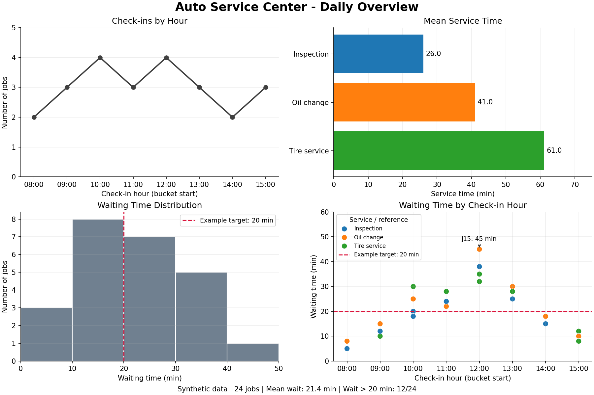
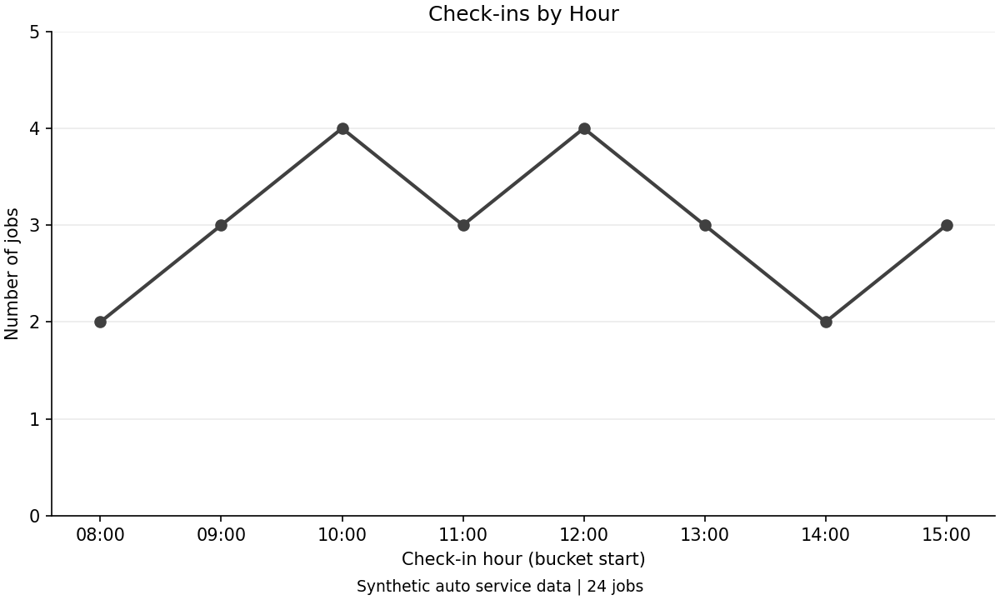
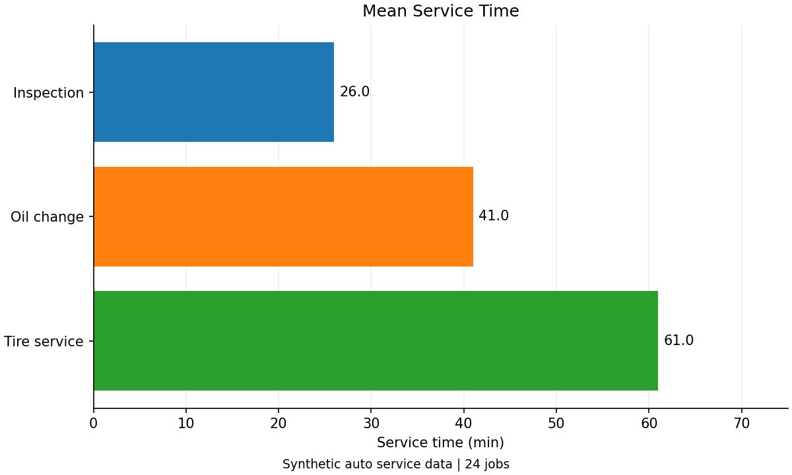
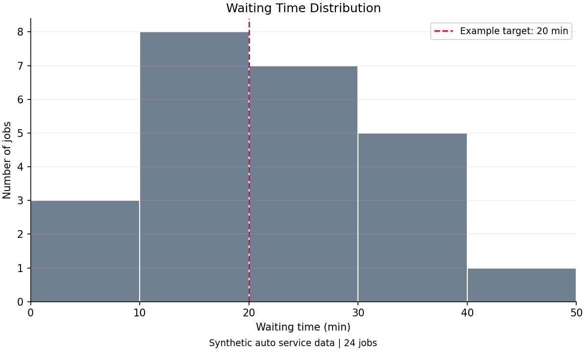
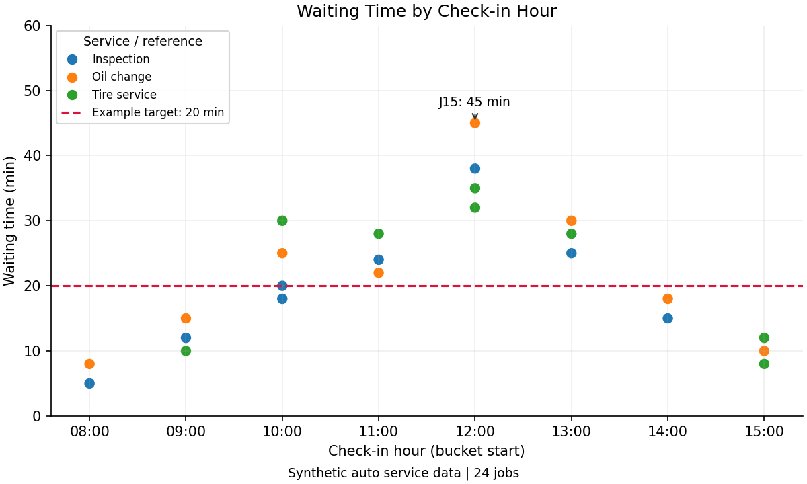

# EP15 — Visualization Mini Project

## รายงานประจำวันของศูนย์บริการรถยนต์

โครงงานนี้นำ Pandas, Matplotlib และ Seaborn มาทำงานร่วมกัน ตั้งแต่เตรียมข้อมูลจนได้รายงานหนึ่งภาพ

ใช้ข้อมูลสมมติ 24 งานของศูนย์บริการรถยนต์ แบ่งเป็นงานตรวจสภาพ เปลี่ยนน้ำมันเครื่อง และบริการยาง

สร้างกราฟทีละใบ แล้วนำฟังก์ชันวาดกราฟเดิมมารวมใน Dashboard แบบ 2×2

ข้อมูลนี้ไม่ใช่ข้อมูลศูนย์บริการจริง และไม่ใช้เป็นมาตรฐานเวลา เกณฑ์ประเมินพนักงาน หรือข้อสรุปด้านกำลังให้บริการ

## สิ่งที่จะได้เรียนรู้

- ตั้งคำถามก่อนเลือกกราฟ
- แยกข้อมูลแต่ละงานออกจากตารางสรุป
- ตรวจจำนวนรายการ ค่าว่าง หน่วย และขอบเขตข้อมูล
- ใช้สีของประเภทบริการให้ตรงกันระหว่างกราฟ
- ใช้ Tick, Legend, เส้นอ้างอิง และ Annotation ร่วมกัน
- เขียนฟังก์ชันวาดลงใน Axes เพื่อใช้ได้ทั้งกราฟเดี่ยวและ Dashboard
- บันทึกภาพและตรวจว่าตัวเลขในรายงานตรงกับข้อมูล

## สิ่งที่ต้องเตรียม

พื้นฐานที่ใช้ ได้แก่ DataFrame, การเลือกคอลัมน์, ฟังก์ชัน Python, Figure, Axes และ Subplots

ติดตั้งไลบรารีจากโฟลเดอร์หลักของ Repository:

~~~bash
python -m pip install -r ep15-visualization-mini-project/requirements.txt
~~~

ทดสอบด้วย Python 3.13.7, NumPy 2.2.6, Pandas 2.3.2, Matplotlib 3.10.3 และ Seaborn 0.13.2

ใช้ Virtual Environment แยกจากโปรเจกต์อื่นได้

ตัวอย่างใช้ข้อมูลที่กำหนดไว้ในโค้ด ไม่ต้องดาวน์โหลด Dataset และไม่เรียกบริการออนไลน์ขณะรัน

รันโค้ดใน README ตามลำดับหัวข้อ โดยหัวข้อ 5–8 จะนิยามฟังก์ชันที่นำกลับมาใช้ในหัวข้อ 9

ข้อความในกราฟเป็นภาษาอังกฤษ จึงไม่ต้องติดตั้งฟอนต์ภาษาไทยเพิ่มเติม

## 1. กำหนดคำถามและขอบเขตโครงงาน

ข้อมูลหนึ่งแถวหมายถึงงานบริการหนึ่งรายการ

แต่ละรายการมีบริการหลักเพียงประเภทเดียวในตัวอย่างนี้

ติดตามงานที่รับรถในช่วง 08:00–15:59 ของวันสมมติหนึ่งวันจนเสร็จ จึงทราบทั้งเวลารอและเวลาให้บริการ

ไม่ได้หมายความว่างานทั้งหมดต้องเสร็จก่อน 16:00

| คำถาม | ข้อมูลที่ใช้ | กราฟ |
|---|---|---|
| ช่วงไหนรับงานเข้ามามาก? | จำนวนรายการในแต่ละชั่วโมงรับรถ | Line Plot |
| งานแต่ละประเภทใช้เวลาให้บริการเฉลี่ยเท่าไร? | ค่าเฉลี่ย `service_min` แยกตามประเภท | Horizontal Bar Plot |
| เวลารอคิวส่วนใหญ่อยู่ในช่วงไหน? | `wait_min` ของทุกงาน | Histogram |
| งานที่รอนานรับรถเข้ามาช่วงไหน? | ชั่วโมงรับรถ เวลารอ และประเภทบริการ | Scatter Plot |

**เวลารอคิว** คือเวลาตั้งแต่รับรถจนเริ่มให้บริการ

**เวลาให้บริการ** คือเวลาตั้งแต่เริ่มงานจนงานเสร็จ

สองค่านี้มีหน่วยเป็นนาทีเหมือนกัน แต่ตอบคนละคำถาม

กำหนดเกณฑ์ตัวอย่างว่า เวลารอไม่เกิน 20 นาทีอยู่ภายในเป้าหมาย

ดังนั้น “เกินเป้าหมาย” ในบทนี้หมายถึง `wait_min > 20` ไม่ใช่ `>= 20`

เกณฑ์นี้ตั้งขึ้นเพื่อฝึกแสดงเส้นอ้างอิง ไม่ใช่เกณฑ์มาตรฐานของอุตสาหกรรม

## 2. เตรียมข้อมูลศูนย์บริการรถยนต์

| คอลัมน์ | ความหมาย |
|---|---|
| `job_id` | รหัสงาน ไม่ซ้ำกัน |
| `hour` | ชั่วโมงเริ่มต้นของช่วงที่รับรถ เช่น 8 แทน 08:00–08:59 |
| `service_type` | ประเภทบริการหลักของงาน |
| `wait_min` | เวลารอก่อนเริ่มบริการ หน่วยนาที |
| `service_min` | เวลาที่ใช้ให้บริการ หน่วยนาที |

`hour` เป็นช่วงเวลาระดับชั่วโมง ไม่ใช่เวลารับรถที่แม่นยำถึงนาที

~~~python
import numpy as np
import pandas as pd
import matplotlib.pyplot as plt
import matplotlib.ticker as mticker
import seaborn as sns

records = [
    ("J01", 8, "Inspection", 5, 20),
    ("J02", 8, "Oil change", 8, 35),
    ("J03", 9, "Tire service", 10, 55),
    ("J04", 9, "Inspection", 12, 25),
    ("J05", 9, "Oil change", 15, 40),
    ("J06", 10, "Inspection", 20, 30),
    ("J07", 10, "Oil change", 25, 45),
    ("J08", 10, "Tire service", 30, 60),
    ("J09", 10, "Inspection", 18, 25),
    ("J10", 11, "Oil change", 22, 40),
    ("J11", 11, "Tire service", 28, 65),
    ("J12", 11, "Inspection", 24, 30),
    ("J13", 12, "Tire service", 32, 60),
    ("J14", 12, "Inspection", 38, 33),
    ("J15", 12, "Oil change", 45, 48),
    ("J16", 12, "Tire service", 35, 68),
    ("J17", 13, "Inspection", 25, 25),
    ("J18", 13, "Oil change", 30, 45),
    ("J19", 13, "Tire service", 28, 65),
    ("J20", 14, "Oil change", 18, 35),
    ("J21", 14, "Inspection", 15, 20),
    ("J22", 15, "Tire service", 12, 55),
    ("J23", 15, "Oil change", 10, 40),
    ("J24", 15, "Tire service", 8, 60),
]

jobs = pd.DataFrame(
    records,
    columns=["job_id", "hour", "service_type", "wait_min", "service_min"],
)

HOURS = list(range(8, 16))
SERVICE_ORDER = ["Inspection", "Oil change", "Tire service"]
SERVICE_COLORS = {
    "Inspection": "tab:blue",
    "Oil change": "tab:orange",
    "Tire service": "tab:green",
}
WAIT_TARGET = 20
WAIT_BINS = [0, 10, 20, 30, 40, 50]

print(jobs.head())
print(jobs.shape)
~~~

ตารางมีขนาด `(24, 5)` คือ 24 แถว และ 5 คอลัมน์

เช่น J01 เป็นงานตรวจสภาพ รับรถในช่วง 08:00–08:59 รอคิว 5 นาที และใช้เวลาให้บริการ 20 นาที

`HOURS` มีค่า 8 ถึง 15 เพราะ `range(8, 16)` ไม่รวม 16

`SERVICE_ORDER` กำหนดลำดับประเภทบริการ ส่วน `SERVICE_COLORS` จับคู่ประเภทกับสีที่จะใช้ทั้งบท

ชื่อที่เขียนด้วยตัวพิมพ์ใหญ่เป็นข้อตกลงการตั้งชื่อตัวแปรสำหรับค่ากำหนดร่วม ไม่ใช่คำสั่งพิเศษของ Python

## 3. ตรวจข้อมูลก่อนสร้างกราฟ

การตรวจนี้หยุดตัวอย่างเมื่อพบข้อมูลที่ไม่ตรงกับเงื่อนไข ไม่ได้แก้ไขหรือลบข้อมูลให้เอง

~~~python
assert not jobs.empty
assert jobs["job_id"].is_unique
assert jobs.notna().all().all()

numeric = jobs[["hour", "wait_min", "service_min"]]
assert np.isfinite(numeric.to_numpy()).all()

assert jobs["hour"].isin(HOURS).all()
assert jobs["service_type"].isin(SERVICE_ORDER).all()
assert (jobs["wait_min"] >= 0).all()
assert (jobs["service_min"] > 0).all()

print(jobs["service_type"].value_counts())
~~~

`is_unique` ตรวจว่ารหัสงานไม่ซ้ำ

`notna()` ตรวจว่ามีข้อมูล ไม่เป็นค่าว่าง

`np.isfinite()` ตรวจว่าไม่ใช่ `NaN` หรือค่าอนันต์

`isin()` ตรวจว่าชั่วโมงและชื่อประเภทอยู่ในชุดที่กำหนดไว้

`all()` ต้องการให้ทุกค่าผ่านเงื่อนไข

ข้อมูลเดิมผ่านการตรวจ และมีประเภทละ 8 งาน

เวลารอเป็นศูนย์ได้ หมายถึงเริ่มบริการได้ทันที แต่ตัวอย่างนี้กำหนดให้เวลาให้บริการต้องมากกว่าศูนย์

ถ้าพบเวลาติดลบ ไม่ควรใช้ `clip()` เปลี่ยนเป็นศูนย์ทันที เพราะอาจปิดบังปัญหาจากแหล่งข้อมูล

การตรวจข้อมูลในสคริปต์

ตัวอย่างใน README ใช้ `assert` เพื่อแสดงเงื่อนไขอย่างสั้น

สคริปต์ใช้ `validate_jobs()` และแจ้ง `ValueError` พร้อมสาเหตุ โดยตรวจชนิดข้อมูลตัวเลขด้วย

การตรวจในสคริปต์จึงไม่ขึ้นกับการเปิดหรือปิด `assert` ของ Python

การไม่มีรายการในชั่วโมงหนึ่งจะแทนจำนวนศูนย์ได้ก็ต่อเมื่อทราบว่าบันทึกครบแล้ว

ถ้าข้อมูลหายเพราะระบบบันทึกขัดข้อง ต้องแยก “ไม่มีงาน” ออกจาก “ไม่มีข้อมูล” ก่อนทำรายงาน

## 4. สรุปข้อมูลให้ตรงกับคำถาม

กราฟจำนวนงานต้องนับรายการ ส่วนกราฟเวลาเฉลี่ยต้องคำนวณเวลาของแต่ละกลุ่ม

~~~python
hourly_jobs = (
    jobs.groupby("hour")
    .size()
    .reindex(HOURS, fill_value=0)
)

mean_service = (
    jobs.groupby("service_type")["service_min"]
    .mean()
    .reindex(SERVICE_ORDER)
)

total_jobs = len(jobs)
mean_wait = jobs["wait_min"].mean()
over_target = (jobs["wait_min"] > WAIT_TARGET).sum()

print(hourly_jobs)
print(mean_service)
print(f"Mean wait: {mean_wait:.1f} min")
print(f"Wait > {WAIT_TARGET} min: {over_target}/{total_jobs}")
~~~

`groupby("hour").size()` นับจำนวนแถวในแต่ละชั่วโมงรับรถ

`reindex(HOURS, fill_value=0)` จัดให้มีทุกชั่วโมงตามลำดับ และใส่ศูนย์เฉพาะชั่วโมงที่ไม่มีรายการในข้อมูลที่บันทึกครบนี้

จำนวนงานตามชั่วโมง 08:00 ถึง 15:00 คือ **2, 3, 4, 3, 4, 3, 2, 3** รวม 24 งาน

`groupby("service_type")["service_min"].mean()` คำนวณเวลาให้บริการเฉลี่ยแยกตามประเภท

| ประเภทบริการ | จำนวนงาน | เวลาให้บริการเฉลี่ย |
|---|---:|---:|
| Inspection | 8 | 26.0 นาที |
| Oil change | 8 | 41.0 นาที |
| Tire service | 8 | 61.0 นาที |

เวลารอเฉลี่ยของทุกงานเท่ากับ 21.375 นาที แสดงทศนิยมหนึ่งตำแหน่งเป็น 21.4 นาที

มีงานที่รอ **เกิน 20 นาที 12 จาก 24 งาน** หรือ 50%

J06 รอ 20 นาทีพอดี จึงไม่อยู่ในจำนวนที่เกินเป้าหมาย

เวลาเฉลี่ยของกลุ่มที่ไม่มีงานคำนวณไม่ได้ จึงไม่ใช้ `fill_value=0` กับ `mean_service`

## 5. แสดงจำนวนงานรับเข้ารายชั่วโมง

ฟังก์ชันต่อไปนี้รับ `ax` เป็นพื้นที่ที่จะวาด และรับ `hourly_jobs` เป็นข้อมูลสรุป

ฟังก์ชันไม่ได้สร้าง Figure ของตัวเอง จึงนำไปใช้ในช่องใดของ Dashboard ก็ได้

~~~python
def format_hour_axis(ax):
    ax.set_xticks(HOURS)
    ax.xaxis.set_major_formatter(
        mticker.StrMethodFormatter("{x:02.0f}:00")
    )
    ax.set_xlim(HOURS[0] - 0.4, HOURS[-1] + 0.4)

def plot_intake(ax, hourly_jobs):
    ax.plot(
        hourly_jobs.index, hourly_jobs.values,
        color="0.25", marker="o", linewidth=2,
    )
    ax.set(
        title="Check-ins by Hour",
        xlabel="Check-in hour (bucket start)",
        ylabel="Number of jobs",
        ylim=(0, max(5, hourly_jobs.max() + 1)),
    )
    format_hour_axis(ax)
    ax.yaxis.set_major_locator(mticker.MaxNLocator(integer=True))
    ax.grid(axis="y", alpha=0.25)

fig, ax = plt.subplots(figsize=(8, 4.8), layout="constrained")
plot_intake(ax, hourly_jobs)
plt.show()
~~~

หนึ่งจุดแทนจำนวนงานที่รับเข้าในช่วงหนึ่งชั่วโมง ไม่ใช่จำนวนรถที่กำลังรออยู่ในศูนย์

ช่วง 10:00–10:59 และ 12:00–12:59 มีจำนวนงานสูงสุดเท่ากัน คือช่วงละ 4 งาน

เส้นเชื่อมช่วยติดตามรูปแบบตามชั่วโมง ไม่ได้หมายความว่าทราบจำนวนงานทุกนาทีระหว่างจุด

`StrMethodFormatter("{x:02.0f}:00")` แสดงค่า 8 เป็น `08:00` โดยไม่เปลี่ยนข้อมูลบนแกน

`02.0f` แสดงตัวเลขโดยไม่มีทศนิยม ใช้ความกว้างอย่างน้อยสองหลัก และเติมศูนย์ด้านหน้า

`MaxNLocator(integer=True)` ทำให้ Tick ของจำนวนงานใช้จำนวนเต็ม

## 6. เปรียบเทียบเวลาให้บริการเฉลี่ย

ใช้กราฟแท่งแนวนอนเพื่อให้ชื่อบริการอ่านได้โดยไม่ต้องหมุนข้อความ

~~~python
def plot_service_time(ax, mean_service):
    values = mean_service.dropna()
    bars = ax.barh(
        values.index, values.values,
        color=[SERVICE_COLORS[name] for name in values.index],
    )
    ax.invert_yaxis()
    ax.bar_label(bars, fmt="%.1f", padding=4)
    ax.set(
        title="Mean Service Time",
        xlabel="Service time (min)",
        xlim=(0, max(75, values.max() * 1.2)),
    )
    ax.grid(axis="x", alpha=0.20)
    ax.set_axisbelow(True)

fig, ax = plt.subplots(figsize=(8, 4.8), layout="constrained")
plot_service_time(ax, mean_service)
plt.show()
~~~

`barh()` รับค่าความยาวแท่งที่คำนวณไว้แล้ว ไม่ได้คำนวณค่าเฉลี่ยให้อัตโนมัติแบบ `sns.barplot()` ใน EP14

`invert_yaxis()` ทำให้ประเภทแรกในลำดับอยู่ด้านบน

`bar_label()` ใส่ค่าของแท่ง และ `fmt="%.1f"` แสดงทศนิยมหนึ่งตำแหน่ง

แกนจำนวนเวลาเริ่มที่ศูนย์ เพราะความยาวแท่งใช้แทนขนาดของค่าเฉลี่ย

สีของแต่ละประเภทกำหนดจาก `SERVICE_COLORS` ซึ่งจะใช้ซ้ำกับ Scatter

`dropna()` ในฟังก์ชันนี้ละประเภทที่ไม่มีค่าเฉลี่ยออกจากกราฟ ไม่ได้เปลี่ยนค่าว่างให้เป็นศูนย์

บริการยางใช้เวลาเฉลี่ยมากกว่าในข้อมูลสมมตินี้ แต่ไม่ใช่หลักฐานว่าทีมงานบริการยางทำงานช้าหรือด้อยกว่า เพราะเป็นงานคนละประเภท

## 7. ดูการกระจายเวลารอคิว

Histogram ใช้เวลารอของทั้ง 24 งาน ไม่ใช่เวลาให้บริการหรือค่าเฉลี่ยรายชั่วโมง

~~~python
def plot_wait_distribution(ax, jobs, wait_target):
    if not jobs["wait_min"].between(WAIT_BINS[0], WAIT_BINS[-1]).all():
        raise ValueError("Extend WAIT_BINS to include every waiting time.")

    ax.hist(
        jobs["wait_min"], bins=WAIT_BINS,
        color="slategray", edgecolor="white",
    )
    ax.axvline(
        wait_target, color="crimson", linestyle="--",
        label=f"Example target: {wait_target:g} min",
    )
    ax.set(
        title="Waiting Time Distribution",
        xlabel="Waiting time (min)",
        ylabel="Number of jobs",
        xticks=WAIT_BINS,
        xlim=(0, max(WAIT_BINS[-1], wait_target + 5)),
    )
    ax.yaxis.set_major_locator(mticker.MaxNLocator(integer=True))
    ax.grid(axis="y", alpha=0.20)
    ax.legend(fontsize=9)

fig, ax = plt.subplots(figsize=(8, 4.8), layout="constrained")
plot_wait_distribution(ax, jobs, WAIT_TARGET)
plt.show()
~~~

ขอบ `[0, 10, 20, 30, 40, 50]` แบ่งออกเป็นห้าช่วง ช่วงละสิบนาที

ความสูงแท่งตามลำดับคือ **3, 8, 7, 5, 1** รวม 24 งาน

ค่าที่ตรงขอบ เช่น 20 จะอยู่ในช่วง 20–น้อยกว่า 30 นาที ส่วนช่วงสุดท้ายรวมขอบขวาสุดด้วย

`axvline()` แสดงเส้นแนวตั้งที่ตำแหน่งเวลารอ 20 นาที

ไม่ควรนับงานที่เกินเป้าหมายจากแท่งทางขวาของเส้นอย่างเดียว เพราะแท่งช่วง 20–30 รวมงานที่รอ 20 นาทีพอดีด้วย

จำนวนที่เกินเป้าหมายจึงคำนวณจากเงื่อนไข `jobs["wait_min"] > WAIT_TARGET` โดยตรง

หากเพิ่มข้อมูลที่รอเกิน 50 นาที ต้องขยาย `WAIT_BINS` ก่อน ไม่ควรปล่อยให้ Histogram ตัดข้อมูลนอกขอบช่วงโดยไม่ทราบ

## 8. สำรวจเวลารอคิวตามช่วงเวลารับรถ

ใช้ Seaborn วาดจุดแทนงานแต่ละรายการ และใช้ Matplotlib เพิ่มเส้นอ้างอิงกับ Annotation

~~~python
def plot_wait_by_hour(ax, jobs, wait_target):
    sns.scatterplot(
        data=jobs, x="hour", y="wait_min",
        hue="service_type", hue_order=SERVICE_ORDER,
        palette=SERVICE_COLORS, s=65, ax=ax,
    )
    ax.axhline(
        wait_target, color="crimson", linestyle="--",
        label=f"Example target: {wait_target:g} min",
    )

    longest = jobs.loc[jobs["wait_min"].idxmax()]
    ax.annotate(
        f"{longest['job_id']}: {longest['wait_min']:g} min",
        xy=(longest["hour"], longest["wait_min"]),
        xytext=(0, 12), textcoords="offset points",
        ha="center", fontsize=9,
        arrowprops={"arrowstyle": "->", "color": "0.2"},
    )

    ax.set(
        title="Waiting Time by Check-in Hour",
        xlabel="Check-in hour (bucket start)",
        ylabel="Waiting time (min)",
        ylim=(0, max(60, jobs["wait_min"].max() + 15, wait_target + 15)),
    )
    format_hour_axis(ax)
    ax.grid(alpha=0.20)
    ax.legend(title="Service / reference", loc="upper left", fontsize=8, title_fontsize=9)

fig, ax = plt.subplots(figsize=(8, 4.8), layout="constrained")
plot_wait_by_hour(ax, jobs, WAIT_TARGET)
plt.show()
~~~

หนึ่งจุดแทนหนึ่งงาน รวม 24 จุด

หลายจุดมีค่า X เท่ากันได้ เพราะรับรถในช่วงชั่วโมงเดียวกัน แต่มีเวลารอต่างกัน

เส้นอ้างอิงใช้ `axhline()` เพราะเวลารออยู่บนแกน Y ต่างจาก Histogram ที่เวลารออยู่บนแกน X

`idxmax()` คืนชื่อ Index ของแถวที่มีเวลารอสูงสุด แล้ว `loc` ใช้เลือกข้อมูลแถวนั้น

ข้อมูลเดิมได้งาน J15 ช่วง 12:00–12:59 รอ 45 นาที

หากมีค่าสูงสุดเท่ากันหลายแถว คำสั่งนี้จะเลือกแถวแรกที่พบ

`xy` ใช้พิกัดข้อมูลตามค่าเริ่มต้น ส่วน `xytext=(0, 12)` กับ `textcoords="offset points"` วางข้อความเหนือจุด 12 points

ตำแหน่งบนแกนยังเป็นชั่วโมง 12 ไม่ได้หมายความว่ารับรถเวลา 12:00 พอดี

กราฟแสดงรูปแบบของข้อมูล แต่ยังไม่พิสูจน์สาเหตุของการรอนาน เช่น จำนวนช่างหรือช่องซ่อม เพราะไม่มีข้อมูลเหล่านั้นในตาราง

## 9. รวมกราฟเป็น Dashboard

ฟังก์ชันจากหัวข้อ 5–8 วาดลงใน `ax` ที่ส่งให้ จึงไม่ต้องเขียนคำสั่งวาดกราฟใหม่ทั้งชุด

| ตำแหน่ง | เนื้อหา |
|---|---|
| `axes[0, 0]` บนซ้าย | จำนวนงานรายชั่วโมง |
| `axes[0, 1]` บนขวา | เวลาให้บริการเฉลี่ย |
| `axes[1, 0]` ล่างซ้าย | การกระจายเวลารอ |
| `axes[1, 1]` ล่างขวา | เวลารอของแต่ละงานตามชั่วโมงรับรถ |

~~~python
report_style = {
    "font.size": 10,
    "axes.titlesize": 12,
    "axes.spines.top": False,
    "axes.spines.right": False,
}

with plt.style.context("default"), plt.rc_context(report_style):
    fig, axes = plt.subplots(
        2, 2, figsize=(12, 8), layout="constrained",
    )
    plot_intake(axes[0, 0], hourly_jobs)
    plot_service_time(axes[0, 1], mean_service)
    plot_wait_distribution(axes[1, 0], jobs, WAIT_TARGET)
    plot_wait_by_hour(axes[1, 1], jobs, WAIT_TARGET)

    fig.suptitle(
        "Auto Service Center - Daily Overview",
        fontsize=17, fontweight="bold",
    )
    total_jobs = len(jobs)
    mean_wait = jobs["wait_min"].mean()
    over_target = (jobs["wait_min"] > WAIT_TARGET).sum()
    fig.supxlabel(
        f"Synthetic data | {total_jobs} jobs | Mean wait: {mean_wait:.1f} min | "
        f"Wait > {WAIT_TARGET:g} min: {over_target}/{total_jobs}",
        fontsize=10,
    )

plt.show()
~~~

`layout="constrained"` ช่วยจัดพื้นที่ให้ชื่อกราฟ ชื่อแกน และป้าย Tick

ไม่ใช้ `sharex=True` หรือ `sharey=True` กับทั้งสี่ช่อง เพราะแกนของแต่ละกราฟมีคนละความหมายและหน่วย

`with` จำกัดการตั้งค่ารูปแบบไว้ในช่วงสร้างรายงาน เมื่อออกจากบล็อก ค่าเริ่มต้นเดิมจะกลับมา แต่ Figure ที่สร้างแล้วไม่ได้หายไป

`fig.suptitle()` เป็นชื่อรวม ส่วน `fig.supxlabel()` ในตัวอย่างนี้ใช้แสดงข้อความสรุปด้านล่างของ Figure

ข้อความสรุปคำนวณจากข้อมูลและเป้าหมายชุดเดียวกับที่ใช้วาดกราฟ

สีของ Bar และ Scatter ตรงกันตามประเภทบริการ ส่วนกราฟจำนวนงานและ Histogram ใช้สีเทาเพราะรวมทุกประเภท

## 10. บันทึกรายงานและตรวจผลลัพธ์

บันทึกผ่านตัวแปร `fig` ที่อ้างถึง Dashboard จากหัวข้อ 9:

~~~python
from pathlib import Path

output_dir = Path("output")
output_dir.mkdir(parents=True, exist_ok=True)
output_path = output_dir / "service-center-report.png"
fig.savefig(output_path, dpi=150)
print(output_path.resolve())
~~~

Figure ขนาด 12×8 นิ้ว เมื่อบันทึกที่ 150 DPI จะได้ภาพ 1800×1200 พิกเซล หากไม่ได้ตัดขอบเพิ่มเติม

`output` ในโค้ดนี้อ้างจาก Working Directory ปัจจุบัน

หากสร้างกราฟอื่นแล้วใช้ชื่อ `fig` ซ้ำ ต้องตรวจว่าตัวแปรยังอ้างถึงรูปที่ต้องการก่อนบันทึก

รายการตรวจรายงาน:

- ตารางต้นทางมี 24 งาน และประเภทละ 8 งาน
- จำนวนงานจากกราฟรายชั่วโมงรวมกันเป็น 24
- เวลาให้บริการเฉลี่ยเป็น 26.0, 41.0 และ 61.0 นาที
- ความสูงแท่ง Histogram รวมกันเป็น 24
- Scatter มีข้อมูลครบ 24 จุด และสีตรงกับประเภทบริการ
- Annotation ชี้ J15 ที่ชั่วโมง 12 และเวลารอ 45 นาที
- งานที่รอเกิน 20 นาทีมี 12 งาน ไม่รวมงานที่รอ 20 นาทีพอดี
- ไม่มีชื่อแกน Legend หรือ Annotation ถูกตัดออกจากภาพ

ภาพนี้เป็นรายงานแบบคงที่ ไม่ใช่ระบบติดตามแบบ Real-time

ถ้าข้อมูลหรือเกณฑ์เปลี่ยน ต้องคำนวณตารางสรุปใหม่และสร้างรายงานอีกครั้ง

การอ่านข้อค้นพบและข้อจำกัด

ช่วง 10:00 และ 12:00 มีงานรับเข้าเท่ากันที่ 4 งาน แต่เวลารอของงานในสองช่วงไม่เหมือนกัน

จำนวนรับเข้าเพียงค่าเดียวจึงไม่เพียงพอจะอธิบายเวลารอ

Bar Plot แสดงความต่างของเวลาให้บริการระหว่างงานคนละประเภท ไม่ใช่การจัดอันดับประสิทธิภาพทีมงาน

ค่าเฉลี่ยรวม 21.4 นาทีไม่ได้หมายความว่าทุกงานรอใกล้ 21.4 นาที จึงมีทั้ง Histogram และจุดข้อมูลประกอบ

ข้อมูลหนึ่งวันไม่เพียงพอสำหรับสรุปรูปแบบระยะยาวหรือกำหนดจำนวนพนักงาน

ถ้าในข้อมูลจริงยังมีงานไม่เสร็จ ไม่ควรใส่เวลาให้บริการเป็นศูนย์ ควรแยกสถานะและระบุขอบเขตรายงานให้ชัด

## แบบฝึกหัด

[แบบฝึกหัด: ปรับรายงานศูนย์บริการรถยนต์](./exercises/exercise01.md)

## ไฟล์ตัวอย่างและวิธีรัน

| ไฟล์ | เนื้อหา |
|---|---|
| [requirements.txt](./requirements.txt) | ไลบรารีของบท |
| [service_data.py](./source-code/service_data.py) | ข้อมูล ค่ากำหนด การตรวจ และตารางสรุป |
| [service_plots.py](./source-code/service_plots.py) | ฟังก์ชันวาดกราฟสี่แบบลงใน Axes |
| [service_report.py](./source-code/service_report.py) | ประกอบรายงานและบันทึก PNG |
| [generate_lesson_figures.py](./source-code/generate_lesson_figures.py) | สร้างภาพประกอบทั้งห้าภาพ |
| [test_examples.py](./tests/test_examples.py) | ตรวจข้อมูล โค้ดใน README กราฟ และไฟล์ภาพ |

เปิดรายงานจากโฟลเดอร์หลักของ Repository:

~~~bash
python ep15-visualization-mini-project/source-code/service_report.py
~~~

บันทึกภาพโดยไม่เปิดหน้าต่างกราฟ:

~~~bash
python ep15-visualization-mini-project/source-code/service_report.py --output output/ep15/service-center-report.png --no-show
~~~

ใช้เป้าหมายตัวอย่าง 30 นาทีและบันทึกเป็นอีกไฟล์:

~~~bash
python ep15-visualization-mini-project/source-code/service_report.py --wait-target 30 --output output/ep15/service-center-target30.png --no-show
~~~

คำสั่งนี้เปลี่ยนทั้งเส้นอ้างอิงและจำนวนที่เกินเป้าหมาย โดยข้อมูลเดิมไม่เปลี่ยน

รันจากโฟลเดอร์ `source-code` ได้เช่นกัน โดยใช้ชื่อไฟล์ `python service_report.py`

สร้างภาพประกอบ README ใหม่:

~~~bash
python ep15-visualization-mini-project/source-code/generate_lesson_figures.py
~~~

สคริปต์นี้หา `assets/plots` จากตำแหน่งไฟล์สคริปต์ จึงไม่ขึ้นกับโฟลเดอร์ที่ใช้รัน

เลือกปลายทางอื่นได้ด้วย `--output-dir output/ep15/plots`

ทดสอบจากโฟลเดอร์หลัก:

~~~bash
python -m unittest discover -s ep15-visualization-mini-project/tests -v
~~~

## สรุป

ข้อมูลแต่ละงานเป็นจุดเริ่มต้น ส่วนตารางสรุปและกราฟเป็นมุมมองที่สร้างจากข้อมูลนั้น

การแยกฟังก์ชันวาดกราฟออกจากการสร้าง Figure ทำให้ตรวจกราฟเดี่ยวได้ และนำกลับมาใช้ใน Dashboard ได้

ชื่อแกน หน่วย สี เส้นอ้างอิง และตัวเลขสรุปต้องสอดคล้องกันทั้งรายงาน

## แหล่งอ้างอิง

กรณีศึกษา ข้อมูล และตัวอย่างในโครงงานนี้จัดทำขึ้นใหม่ โดยตรวจรูปแบบ API จากเอกสารทางการ:

- [Pandas — Group by: split-apply-combine](https://pandas.pydata.org/docs/user_guide/groupby.html)
- [Pandas — DataFrame.reindex](https://pandas.pydata.org/docs/reference/api/pandas.DataFrame.reindex.html)
- [Matplotlib — subplots](https://matplotlib.org/stable/api/_as_gen/matplotlib.pyplot.subplots.html)
- [Matplotlib — Axes.barh](https://matplotlib.org/stable/api/_as_gen/matplotlib.axes.Axes.barh.html)
- [Matplotlib — Axes.annotate](https://matplotlib.org/stable/api/_as_gen/matplotlib.axes.Axes.annotate.html)
- [Matplotlib — Figure.savefig](https://matplotlib.org/stable/api/_as_gen/matplotlib.figure.Figure.savefig.html)
- [Seaborn — scatterplot](https://seaborn.pydata.org/generated/seaborn.scatterplot.html)

## ตอนก่อนหน้า

**EP14 — [Visualization with Seaborn](../ep14-visualization-with-seaborn/README.md)**

[กลับสารบัญหลัก](../README.md)
